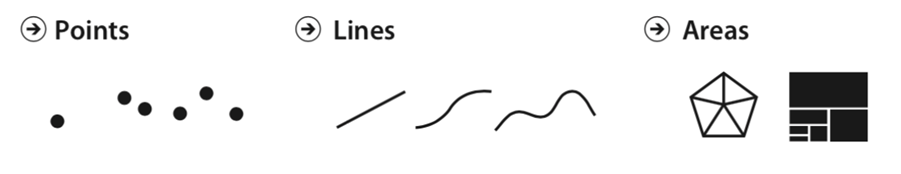
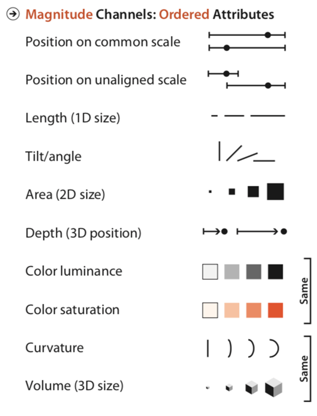
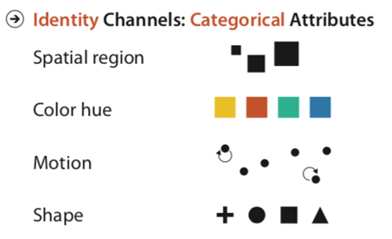
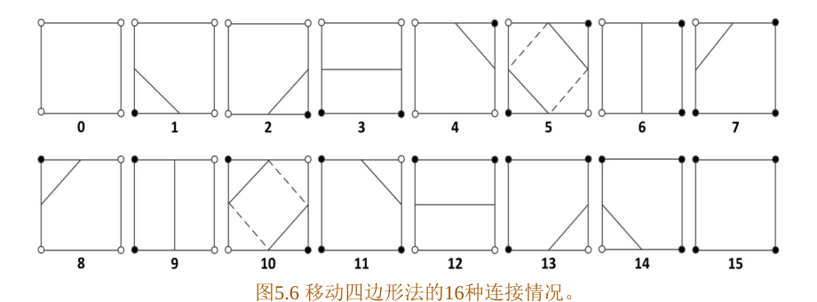

# 第 1 章 数据

数据来源、属性与变换，构成 D3 绘图的基础。

## 1.1 数据生成与读取

### 新生数据案例

本章从一份包含 80 条新生记录的 CSV 文件开始，学习数据的读取、类型转换和整理。CSV 的第一行是字段名，后面每一行是一条记录。原课程的字段包括序号、姓名、性别、生日、年龄、班级、籍贯和民族。

### 字段、记录与数据类型

| 字段示例 | 含义 | 读入后的处理 |
| --- | --- | --- |
| 序号 / id | 标识一条记录 | 保留为标识，用于查找和数据连接 |
| 姓名、班级 | 文本或类别 | 去除首尾空格，统一名称 |
| 年龄、成绩 | 数值 | 从字符串转换为 Number |
| 生日、日期 | 时间 | 按指定格式解析为 Date |

读入 CSV 后，`"18"` 与 `18` 并不是同一种类型。字符串用于显示没有问题，参与加法、排序或计算均值前，需要先完成类型转换。例如 `"18" + "2"` 得到 `"182"`，而 `18 + 2` 得到 `20`。

### 数据读取与行转换

`d3.csv(url, transformRow)` 负责加载和解析 CSV，并把每一行交给 `transformRow`。在这个函数中完成字段重命名、去除空格、数值转换和日期解析，后面的过滤、分组和绘图就可以使用统一的数据结构。

整理数据时还要检查字段是否齐全、同一类别的写法是否一致、日期格式是否统一。空字符串应先单独处理，再做数值转换；`Number("")` 会得到 0。

### 关键代码

#### 1. 字段名映射

```javascript
// 左侧是 CSV 列名，右侧是程序内部使用的字段名。
const COLUMN_MAP = {
  '序号': 'id', '姓名': 'name', '性别': 'gender',
  '生日': 'birthday', '年龄': 'age', '班级': 'class'
};
// Object.entries 把对象转换为 [键, 值] 数组。
const row = {'序号': '1', '姓名': '张明', '年龄': '18'};
const mapped = Object.fromEntries(
  Object.entries(row).map(([key, value]) => [COLUMN_MAP[key] ?? key, value])
);
console.log(mapped); // {id: '1', name: '张明', age: '18'}
```

**关键点解释**

对象中的 `key: value` 建立字段对应关系。`[key, value]` 是数组解构；`?? key` 表示没有配置映射时沿用原列名。中文属性名在 JavaScript 中合法；映射为英文名是为了让后面的代码采用统一命名。此时字段名变了，字段值仍是字符串。

#### 2. 类型转换函数

```javascript
// 先指定格式，再得到一个可重复使用的日期解析函数。
const parseDate = d3.utcParse('%Y-%m-%d');
function transformRow(row) {
  const age = row['年龄'].trim();
  return {
    id: row['序号'],                         // 编号保留字符串。
    name: row['姓名'].trim(),                // 去掉首尾空格。
    birthday: parseDate(row['生日']),        // 字符串转换为 Date。
    age: age === '' ? null : Number(age),   // 空项与数字分别处理。
    class: row['班级'].trim()
  };
}
```

**关键点解释**

`transformRow` 接收一行对象，`return { ... }` 返回新的记录。`Number("18")` 与 `+"18"` 都得到数字 18；`trim()` 处理首尾空格；`utcParse` 按明确格式解释日期。把转换放在同一处，后续计算就不必反复判断字段类型。

#### 3. d3.csv 的行回调与 await

```javascript
// transformRow 是上一段定义的函数，这里传函数本身。
const url = new URL('../assets/data/original-students.csv', import.meta.url);
const students = await d3.csv(url, transformRow);
// await 得到解析后的记录数组，而不是 Promise。
console.log(students.length);                    // 80
console.log(typeof students[0].age);             // 'number'
console.log(students[0].birthday instanceof Date); // true
```

**关键点解释**

`d3.csv` 返回 Promise，可以用 `await` 或 `.then()` 取得结果。第二个参数是行转换函数，D3 会对解析出的每一行调用它，返回值进入最终数组。这里写 `transformRow`，不是 `transformRow()`；后者会立即调用函数。

### 运行示例: 读取 CSV 与转换字段

```javascript
async function csv({svg,d3,n}) {
  // 行回调在解析时转换类型；编号仍是字符串。
  const rows=await d3.csv(new URL('../assets/data/students.csv',import.meta.url),row=>({
    id:row.id, score:row.score.trim()===''?null:Number(row.score)
  }));
  const shown=rows.slice(0,n);
  // 比例尺把成绩转为像素，不修改成绩。
  const x=d3.scaleLinear().domain([0,100]).range([0,440]);
  svg.selectAll('rect').data(shown,d=>d.id).join('rect')
    .attr('x',80).attr('y',(d,i)=>20+i*24).attr('width',d=>x(d.score??0))
    .attr('height',16).attr('fill','#2878ad');
  svg.selectAll('text').data(shown).join('text')
    .attr('x',10).attr('y',(d,i)=>33+i*24).text(d=>d.id);
  return {rows:rows.length,scoreType:typeof rows[0].score,first:rows[0]};
}
```


[D3 官方文档](https://d3js.org/d3-fetch)

### 演示观察

切换原始字符串与转换后的数值，比较成绩列的 typeof；再选中一条记录，观察编号是否改变。

[打开本节](https://mississippipotato.github.io/recreate/#ch-1-1)

## 1.2 数据定义与 DIKW

### DIKW 金字塔

DIKW 分别指数据（Data）、信息（Information）、知识（Knowledge）和智慧（Wisdom）。数据是原始的观察结果，信息是组织好的数据，知识是从信息中提炼的模式和规律，智慧是运用知识作出判断和决策。

| 层 | 含义 | 回答的问题 |
| --- | --- | --- |
| 数据 Data | 原始、离散的观察结果 | 记录了什么 |
| 信息 Information | 经过处理、组织、赋予上下文的数据 | 谁 / 什么 / 何时 / 何地 |
| 知识 Knowledge | 对信息的进一步提炼和理解 | 如何 |
| 智慧 Wisdom | 运用知识作出判断和决策 | 为什么 / 应该怎么做 |

### 可视化在 DIKW 中的位置

可视化把表格中的数据转换成图形，使分布、差异和联系更容易被发现。柱状图可以比较各班人数，折线图可以观察变化，热图可以查找集中出现的高值和低值。

- **Data → Information：**整理和呈现数据，回答具体问题。
- **Information → Knowledge：**比较多个视图，发现模式，结合领域知识、统计分析进一步解释。
- **Knowledge → Wisdom：**结合目标、经验和条件作出决策，可视化提供分析依据。

### 从记录到判断

以新生数据为例：一条记录中的班级、年龄和籍贯属于数据；按班级统计人数形成信息；比较多个班级的构成可以发现规律；结合教学安排决定如何分组，则进入了决策。演示中的四层金字塔用同一份记录说明这个过程。

### 关键代码

#### 1. 用 SVG path 画金字塔的一层

```javascript
const cx = 200;                       // 水平中心。
const topW = 60, bottomW = 120;        // 上边宽度和下边宽度。
const yTop = 20, yBottom = 100;
// M 移到起点，L 连到下一点，Z 闭合路径。
const path = `M ${cx-topW/2} ${yTop}
  L ${cx+topW/2} ${yTop}
  L ${cx+bottomW/2} ${yBottom}
  L ${cx-bottomW/2} ${yBottom} Z`;
const layer = {name:'Data',color:'#2878ad'};
const groups = svg.selectAll('g.layer').data([layer]).join('g').attr('class','layer');
groups.append('path').attr('d', path).attr('fill',d=>d.color);
```

**关键点解释**

`path` 的 `d` 属性保存路径指令。模板字符串中的 `${表达式}` 会先计算坐标，再拼成字符串。改变上下边宽度就可以得到不同梯形；把四层依次排列，就能组成 DIKW 金字塔。

#### 2. 绑定数据、事件与交互高亮

```javascript
// groups 是上一段包含 path 的图层选择集。
groups.on('mouseenter', function(event, d) {
  // 普通函数中的 this 是正在处理事件的 g。
  d3.select(this).select('path').interrupt().transition().duration(150)
    .attr('fill', d3.color(d.color).brighter(0.5));
});
// 箭头函数可用 event.currentTarget 取得相同元素。
groups.on('click', (event, d) => {
  d3.select(event.currentTarget).classed('selected', true);
  console.log(d.name);
});
```

**关键点解释**

`.on(type, listener)` 把事件监听器绑定到选择集，回调参数依次是事件 `event` 和当前数据 `d`。使用 `this` 时写普通函数；使用箭头函数时可以写 `event.currentTarget`。`transition().duration(150)` 在 150 毫秒内插值颜色。

### 运行示例: DIKW 金字塔与路径

```javascript
function dikw({svg,d3,n,L}) {
  const labels=L(['数据','信息','知识','智慧'],['Data','Information','Knowledge','Wisdom']);
  // 每个梯形绑定一层；索引 0 在底部，3 在顶部。
  const layers=labels.map((label,i)=>({label,index:i,top:155-i*48,width:380-i*85}));
  const groups=svg.selectAll('g').data(layers).join('g');
  groups.append('path').attr('d',d=>{
    const cx=300,top=d.top,w=d.width;
    // 按顺序画四个顶点，最后闭合。
    return `M${cx-(w-65)/2},${top}L${cx+(w-65)/2},${top}L${cx+w/2},${top+42}L${cx-w/2},${top+42}Z`;
  }).attr('fill',d=>d.index===n-1?'#e16a45':'#2878ad');
  groups.append('text').attr('x',300).attr('y',d=>d.top+28).attr('text-anchor','middle')
    .attr('fill','white').text(d=>d.label);
  return {selected:labels[n-1],level:n};
}
```


[D3 官方文档](https://d3js.org/d3-selection/events)

### 演示观察

点击金字塔的四层，比较同一份记录如何组织成信息、知识与决策。

[打开本节](https://mississippipotato.github.io/recreate/#ch-1-2)

## 1.3 数据属性与视觉通道

### 数据属性的三种基本类型

- **类别型属性：**符号或名称，没有大小顺序，如姓名、专业和籍贯。
- **序数型属性：**属性值有顺序，如本科、硕士、博士，或低、中、高。
- **数值型属性：**表示可以度量的数量，如年龄、价格、人数和温度。

### Stevens 测量尺度

测量尺度进一步区分了数据允许怎样比较。特别要注意：区间尺度有等距的差值，比率尺度还具有有意义的零点。

| 尺度 | 可以怎样比较 | 典型示例 |
| --- | --- | --- |
| 名义 Nominal | 相同 / 不同 | 姓名、专业、编号 |
| 序数 Ordinal | 相同 / 不同，以及先后或高低 | 等级、名次 |
| 区间 Interval | 比较差值 | 摄氏温度、年份 |
| 比率 Ratio | 比较差值与倍数 | 人数、长度、价格 |

0°C 不表示没有温度，因此不能说 20°C 是 10°C 的两倍。人数则有零点，20 人是 10 人的两倍。编号即使用数字存储，仍然属于类别型属性。

### 属性与视觉通道的匹配

| 表达任务 | 常用通道 | 图形例子 |
| --- | --- | --- |
| 比较数量 | 共用尺度上的位置、长度 | 散点图、柱状图 |
| 表达顺序 | 位置、明度、大小 | 排序图、顺序色带 |
| 区分类别 | 色相、形状、空间分区 | 分类散点、分面图 |

Mackinlay 的视觉通道排序为这种选择提供了依据。先判断字段的含义，再决定使用哪一种比例尺和通道；例如专业用类别颜色，成绩用位置或长度。


### 关键代码

#### 1. 根据属性选择比例尺

```javascript
// 连续数值：成绩 0~100 映射到像素 0~800。
const x = d3.scaleLinear().domain([0, 100]).range([0, 800]);
console.log(x(50)); // 400
// 离散类别：每个班级分到一个带宽相同的区间。
const band = d3.scaleBand()
  .domain(['软件1班', '软件2班']).range([0, 800]).padding(0.1);
console.log(band('软件1班'), band.bandwidth());
// scalePoint 为离散类别分配位置，不分配矩形带宽。
const point = d3.scalePoint().domain(['低','中','高']).range([0, 800]);
```

**关键点解释**

`domain` 是输入域，`range` 是输出域，比例尺本身是可以调用的函数。`x(50)` 得到对应像素；`band(category)` 得到柱子的起点，`bandwidth()` 得到柱宽。数据是连续数量还是离散类别，决定了这里应使用哪类比例尺。

#### 2. 顺序型、发散型和定性型颜色

```javascript
// 有大小顺序：把人数范围先归一化，再调用 Viridis。
const sequential = d3.scaleSequential(d3.interpolateViridis).domain([0, 100]);
// 有基准值：三项 domain 分别是低端、中点、高端。
const diverging = d3.scaleDiverging(d3.interpolateRdBu).domain([-10, 0, 10]);
// 无序类别：显式给出类别与颜色数组。
const categorical = d3.scaleOrdinal()
  .domain(['A', 'B', 'C']).range(d3.schemeTableau10);
console.log(sequential(50), diverging(0), categorical('B'));
```

**关键点解释**

`interpolateViridis(t)` 接收 0 到 1 的参数；`scaleSequential` 负责把原始数值转为这个参数。`scaleDiverging` 还明确一个中点。`scaleOrdinal` 则按类别在颜色数组中查找，不计算类别之间的中间颜色。

### 运行示例: 比例尺与坐标轴

```javascript
function scales({svg,d3,n}) {
  const values=[0,25,50,75,100];
  // domain 是输入，range 是输出；n 控制屏幕宽度。
  const x=d3.scaleLinear().domain([0,100]).range([40,40+n*40]);
  svg.selectAll('circle').data(values).join('circle')
    .attr('cx',d=>x(d)).attr('cy',95).attr('r',8).attr('fill','#2878ad');
  // call 将选择集交给坐标轴生成器。
  svg.append('g').attr('transform','translate(0,130)').call(d3.axisBottom(x).ticks(4));
  return values.map(value=>({value,pixel:x(value)}));
}
```


[D3 官方文档](https://d3js.org/d3-scale/linear)

### 演示观察

切换编号、等级、温度和人数。观察相同的数值，为什么需要不同的颜色逻辑。

[打开本节](https://mississippipotato.github.io/recreate/#ch-1-3)

## 1.4 数据变换

### 常见的数据变换

数据通常需要先整理，再绑定到图形。原课程介绍了八种常见操作，分别处理逐项映射、筛选、组合和数组结构。

| 操作 | 作用 | 简单例子 |
| --- | --- | --- |
| map | 逐项生成新值 | 年龄数组 → 每人下一岁的年龄 |
| reduce | 把多个值归约为一个结果 | 年龄数组 → 总和 |
| cross | 笛卡尔积 | 性别 × 专业 → 所有组合 |
| merge | 把多组数组展开一层 | [[1,2],[3]] → [1,2,3] |
| pairs | 提取相邻元素对 | [1,2,3] → [[1,2],[2,3]] |
| transpose | 交换矩阵的行与列 | 两行三列 → 三行两列 |
| zip | 按相同索引组合 | [1,2] 与 [a,b] → [[1,a],[2,b]] |
| filter | 保留满足条件的记录 | 学生数组 → 某专业的学生 |

### 用函数组合表达数据流

例如计算某一组学生的平均年龄，可以先用 `filter` 选出记录，再用 `map` 提取年龄，最后用 `reduce` 求和。每一步处理上一层的结果，便于逐步检查中间值。

`map` 和 `filter` 会返回新数组；`reduce` 返回什么取决于累加器。写回调时，尽量只计算并返回结果，让输入记录保持不变。

### 分组与聚合

`d3.group` 按字段把记录分组，组内仍保留完整记录；`d3.rollup` 在分组后计算人数、总和或均值。下一章会把“专业 → 班级 → 人数”的多层聚合结果继续转换为树形结构。

### 关键代码

#### 1. filter、map、reduce 的组合

```javascript
// filter 的回调返回布尔值，决定是否保留记录。
const group = students.filter(student => student.gender === '男');
// map 返回与输入长度相同的新数组，这里只保留年龄。
const ages = group.map(student => student.age);
// sum 是累加器；0 是初始值。
const total = ages.reduce((sum, age) => sum + age, 0);
const mean = ages.length ? total / ages.length : null;
console.log({ages, total, mean});
```

**关键点解释**

箭头函数 `student => student.age` 省略了 `return`；如果函数体写成花括号，就需要显式返回。`reduce` 每轮把上次结果作为下一轮的累加器，最终返回这里的数值总和。先保存筛选结果，也避免为求人数再次筛选。

#### 2. cross：笛卡尔积

```javascript
const genders = ['男', '女'];
const majors = ['软件工程', '数据科学'];
// 每个性别与每个专业各组合一次，共 2×2 项。
const pairs = d3.cross(genders, majors);
// 最后的函数把每个组合转换为对象。
const rows = d3.cross(genders, majors, (gender, major) => ({gender, major}));
console.log(pairs, rows);
```

**关键点解释**

`cross` 的输入可以是多个可迭代对象，结果数量是各输入长度的乘积。最后一个参数可以是 reducer，它接收一次组合中的各项。`({gender, major})` 外面的圆括号让箭头函数返回对象字面量。

#### 3. group 与 rollup

```javascript
// group 的每个值仍是完整记录数组。
const byClass = d3.group(students, student => student.class);
// rollup 先分组，再让 reducer 计算每组的值。
const countByClass = d3.rollup(students, group => group.length, student => student.class);
// Map 的 get 按键读取，entries 提供键值对。
console.log(byClass.get('软件工程1班'));
for (const [className, count] of countByClass) console.log(className, count);
```

**关键点解释**

`group` 与 `rollup` 都返回 Map 结构。区别在最内层：前者是记录数组，后者是 reducer 的返回值。`for...of` 遍历 Map 时，每一项是 `[key, value]`，可以直接解构。

### 运行示例: filter → map → sum

```javascript
function arrays({svg,d3,n}) {
  const values=d3.range(1,n+1);
  // 先筛选，再映射；原数组仍保留。
  const result=values.filter(d=>d%2===0).map(d=>d*d);
  const x=d3.scaleBand().domain(d3.range(result.length)).range([30,540]).padding(.25);
  const y=d3.scaleLinear().domain([0,n*n]).range([170,15]);
  svg.selectAll('rect').data(result).join('rect').attr('x',(d,i)=>x(i))
    .attr('y',d=>y(d)).attr('width',x.bandwidth()).attr('height',d=>170-y(d)).attr('fill','#2878ad');
  return {input:values,result,sum:d3.sum(result)};
}
```


[D3 官方文档](https://d3js.org/d3-array/transform)

### 演示观察

选择一种操作，先读输入，再读输出。注意结果的类型、长度和嵌套层数。

[打开本节](https://mississippipotato.github.io/recreate/#ch-1-4)

## 1.5 D3 选择集与数据连接

### D3 选择器

| 方法 | 选择范围 |
| --- | --- |
| d3.select | 第一个匹配的元素 |
| d3.selectAll | 所有匹配的元素 |
| selection.select | 每个父元素中第一个匹配的后代 |
| selection.selectAll | 每个父元素中所有匹配的后代 |
| selection.selectChild | 每个父元素中第一个匹配的直接子元素 |
| selection.selectChildren | 每个父元素中所有匹配的直接子元素 |

这些方法返回的是 **selection（选择集）**。后续的 `attr`、`style`、`text` 和 `on` 都作用于选择集中的元素。

### Data-Join：enter / update / exit

数据连接把数据数组与 DOM 元素对应起来。调用 `selection.data(data, key)` 后，可以根据匹配结果得到三种状态。

| 状态 | 匹配情况 | 常见操作 |
| --- | --- | --- |
| enter | 新数据没有对应元素 | append 创建元素 |
| update | 数据与已有元素匹配 | 更新位置、颜色、文字 |
| exit | 已有元素没有对应的新数据 | remove 移除元素 |

例如旧数据为 A、B、C，新数据为 B、C、D，按字母作 key：B、C 更新，D 进入，A 退出。虽然两次数组长度相同，仍然会同时出现 enter 和 exit。

### key 函数与元素身份

省略 key 时，D3 按索引匹配；使用 `d => d.id` 时，D3 按编号匹配。数据重新排序时，稳定的 key 能保留原来的元素，随后再改变它的位置。`join` 把创建、更新和删除放在同一段流程中处理。


### 关键代码

#### 1. join 的三种回调

```javascript
const circles = svg.selectAll('circle')
  .data(currentData, d => d.id) // 用稳定编号匹配旧元素。
  .join(
    enter => enter.append('circle').attr('fill', '#e16a45'), // 创建。
    update => update.attr('fill', '#2878ad'),                // 复用。
    exit => exit.remove()                                  // 删除。
  );
// join 合并 enter 与 update，后面统一设置位置。
circles.attr('cx', (d, i) => 40 + i * 60).attr('cy', 80).attr('r', 20);
```

**关键点解释**

`enter`、`update`、`exit` 参数都是对应状态的选择集。箭头函数返回创建或更新后的选择集，`join` 才能合并它们并继续链式调用。把公共的大小、位置放在 `join` 后面，可以同时设置新旧元素。

#### 2. 按索引与按 key 匹配

```javascript
const oldData = [{id:'A'}, {id:'B'}, {id:'C'}];
const newData = [{id:'B'}, {id:'C'}, {id:'D'}];
const indexGroup=svg.append('g'), keyGroup=svg.append('g');
indexGroup.selectAll('circle').data(oldData).join('circle');
keyGroup.selectAll('circle').data(oldData,d=>d.id).join('circle');
// 两个独立分组对照，避免一次连接影响另一次连接。
const byIndex = indexGroup.selectAll('circle').data(newData);
// 指定 key：B、C 复用，D 进入，A 退出。
const byId = keyGroup.selectAll('circle').data(newData, d => d.id);
console.log(byId.enter().size(), byId.size(), byId.exit().size());
```

**关键点解释**

这两种写法是两种匹配方式，演示中可以分别选择。`d => d.id` 会对已有元素和新数据求 key，按相同 key 匹配。key 应稳定且能区分记录。重排只改变顺序时，按 key 可以继续使用原来的 DOM 节点。

#### 3. select 与 selectAll

```javascript
// select 取第一个匹配项，常用于容器、标题和单个提示框。
const title = d3.select('#title').text('人数');
// selectAll 可以得到空选择集；数据连接负责补齐元素。
const bars = d3.select('#chart').selectAll('rect.bar')
  .data([3, 5, 8]).join('rect').attr('class', 'bar');
// 回调的 d 是当前数据，i 是当前组中的索引。
bars.attr('x', (d, i) => i * 40).attr('width', 30).attr('height', d => d * 10);
```

**关键点解释**

`selectAll` 找到的是元素，不会自动创建它们。即使开始没有任何 `rect.bar`，`data(...).join("rect")` 也可以创建所需矩形。传给 `attr` 的函数由 D3 逐元素调用，而固定值会应用到整个选择集。

### 运行示例: data → join → attr

```javascript
function join({svg,d3,n}) {
  const rows=['A','B','C','D','E','F','G','H'].slice(0,n).map(id=>({id}));
  // key 按身份匹配；省略时按索引匹配。
  const marks=svg.selectAll('circle').data(rows,d=>d.id);
  const counts={enter:marks.enter().size(),update:marks.size(),exit:marks.exit().size()};
  marks.join(
    // enter 与 update 返回选择集，供后续链式设置。
    enter=>enter.append('circle').attr('fill','#e16a45'),
    update=>update.attr('fill','#2878ad'),
    exit=>exit.remove()
  ).attr('cx',(d,i)=>45+i*65).attr('cy',100).attr('r',22);
  svg.selectAll('text').data(rows,d=>d.id).join('text').attr('x',(d,i)=>45+i*65)
    .attr('y',105).attr('text-anchor','middle').attr('fill','white').text(d=>d.id);
  return counts;
}
```


[D3 官方文档](https://d3js.org/d3-selection/joining)

### 演示观察

比较替换、重排、增加与删除；再切到按索引匹配，观察同一个 DOM 编号对应哪个数据。

[打开本节](https://mississippipotato.github.io/recreate/#ch-1-5)


---

# 第 2 章 数据可视化流程

分组、层次、布局和事件处理，共同组成完整流程。

## 2.1 数据可视化流程

### 三个可视化流程模型

从数据到图形，可以用几个经典模型来理解。Card 模型说明数据经过哪些步骤，Mackinlay 讨论视觉表达的选择，van Wijk 模型把用户交互和知识获取放进了这个过程。

| 模型 | 核心内容 |
| --- | --- |
| Card、Mackinlay 与 Shneiderman（1999） | 原始数据 → 数据表 → 视觉结构 → 视图 |
| Mackinlay（1986） | 根据数据类型考虑表达能力和视觉通道的有效性 |
| van Wijk（2005） | 数据、可视化、感知与探索组成反馈过程 |

### 沿着数据流看每一步

- **数据变换：**从原始记录中清洗、筛选、分组，得到适合分析的数据表。
- **视觉映射：**选择图元和通道，例如用位置表示层次，用颜色区分类别。
- **视图变换与渲染：**根据布局、坐标和绘图区域生成最终图形。
- **交互反馈：**用户选择、过滤或调整参数后，重新计算相应步骤。

本章使用同一份分组数据串联这些步骤：先统计专业和班级人数，再建立层次结构，计算树布局，最后加入展开、选中和事件处理。

### 关键代码

#### 1. 流程节点、箭头与选中状态

```javascript
// defs 中的 marker 是可复用的箭头定义。
svg.append('defs').append('marker').attr('id', 'pipeline-arrow')
  .attr('viewBox', '0 -5 10 10').attr('refX', 8)
  .attr('markerWidth', 6).attr('markerHeight', 6).attr('orient', 'auto')
  .append('path').attr('d', 'M0,-5L10,0L0,5').attr('fill', '#8298aa');
// url(#id) 引用当前 SVG 中的定义。
svg.append('line').attr('x1', 40).attr('x2', 160).attr('y1', 60).attr('y2', 60)
  .attr('stroke', '#8298aa').attr('marker-end', 'url(#pipeline-arrow)');
const nodes = svg.selectAll('g.node').data(stages, d => d.id).join('g').attr('class', 'node');
nodes.on('click', (event, picked) => {
  // picked 是点击项；d 是当前正在设置样式的项。
  nodes.classed('selected', d => d.id === picked.id);
});
```

**关键点解释**

`append` 返回新元素的选择集，因此可以继续设置属性或添加子元素。`marker-end` 引用箭头，`orient="auto"` 让它跟随线段方向。`classed("selected", predicate)` 对每个节点求布尔值，一次更新全部选中状态。

### 运行示例: 状态驱动的流程图

```javascript
function flow({svg,d3,n,L}) {
  const stages=L(['记录','数据表','视觉结构','视图'],['Records','Table','Structure','View']);
  // data 绑定阶段，classed 表达当前选中的状态。
  svg.selectAll('line').data(stages.slice(1)).join('line').attr('x1',(d,i)=>120+i*140)
    .attr('x2',(d,i)=>155+i*140).attr('y1',90).attr('y2',90).attr('stroke','#8298aa');
  svg.selectAll('rect').data(stages).join('rect').classed('chosen',(d,i)=>i===n-1)
    .attr('x',(d,i)=>15+i*140).attr('y',60).attr('width',105).attr('height',60)
    .attr('rx',5).attr('fill',(d,i)=>i===n-1?'#e16a45':'#e8f0f7');
  svg.selectAll('text').data(stages).join('text').attr('x',(d,i)=>67+i*140)
    .attr('y',96).attr('text-anchor','middle').text(d=>d);
  return stages[n-1];
}
```


[D3 官方文档](https://d3js.org/d3-selection/modifying)

### 演示观察

依次查看记录、分组、层次与树图。说出每一步新增了什么结构，哪些原始记录仍然保留。

[打开本节](https://mississippipotato.github.io/recreate/#ch-2-1)

## 2.2 数据分类树：group 与 rollup

### 数据变换：从记录到分组结果

按“专业 / 班级”统计新生人数，是一次多维分组聚合。外层按专业分组，内层按班级分组，每组用记录条数表示人数。

| 操作 | 作用 | 常用写法 |
| --- | --- | --- |
| 清洗 / 过滤 | 去除空项、筛选满足条件的记录 | filter、CSV 行回调 |
| 聚合 / 汇总 | 按 key 分组并计算结果 | d3.group、d3.rollup |
| 连接 / 关联 | 按共同字段关联两份记录 | Map 索引与字段查找 |
| 派生字段 | 从已有字段计算新字段 | 从班级名称提取专业 |

### d3.rollup 的参数与返回值

`d3.rollup(data, reducer, key1, key2, ...)` 先按 key 分组，再把每个最内层的记录数组交给 reducer。`v => v.length` 得到人数，`v => d3.mean(v, d => d.score)` 得到平均分。

- 一个 key 返回单层 Map；两个 key 返回嵌套 Map。
- 使用 `for (const [key, value] of map)` 遍历键值对。
- `group` 保留组内记录，`rollup` 保留聚合结果。

### 切片与下钻

只看某专业，可以先过滤再聚合；展开某专业查看各班人数，则是在聚合结果中向下读取一层。这种“总体 → 局部”的组织方式也常用于 OLAP 和交互分析。

### 关键代码

#### 1. 双层 rollup 与 Map 遍历

```javascript
const nested = d3.rollup(
  students,
  group => group.length,  // reducer 收到最内层的记录数组。
  d => d.major,           // 第一个 key：专业。
  d => d.class            // 第二个 key：班级。
);
// 外层值是 Map，内层值才是人数。
for (const [major, classes] of nested) {
  for (const [className, count] of classes) console.log(major, className, count);
}
```

**关键点解释**

`rollup` 的分组键是可变数量的参数。传两个键就产生两层 Map，读取时也要对应两层。reducer 决定叶子值的类型；把 `group.length` 换成 `d3.mean(...)`，叶子就从人数变成均值。

#### 2. 从班级名称提取专业

```javascript
const className = '软件工程12班';
// ^ 和 $ 限定完整字符串；两组括号分别捕获专业和班号。
const match = className.match(/^(.+?)(\d+班)$/);
const major = match ? match[1] : className;
// match[0] 是完整匹配，match[1] 与 match[2] 是捕获组。
console.log(major, match?.[2]); // 软件工程, 12班
// 派生字段可以直接放在 CSV 的行回调中。
```

**关键点解释**

`.+?` 从较短的匹配开始尝试，`\d+` 匹配一个或多个数字。整个表达式要求结尾是“数字 + 班”，所以多位班号可以一起捕获。`match` 未匹配时为 null，三元表达式提供回退值；`?.` 在 null 时停止属性读取。

### 运行示例: 多层分组与归约

```javascript
function rollup({svg,d3,n}) {
  const rows=d3.range(n*4).map(i=>({major:['A','B','C'][i%3],class:i%2}));
  // 第二参处理组内数组；后面依次是分组键。
  const groups=d3.rollup(rows,group=>group.length,d=>d.major,d=>d.class);
  const flat=Array.from(groups,([major,classes])=>({major,count:d3.sum(classes.values())}));
  svg.selectAll('rect').data(flat).join('rect').attr('x',60).attr('y',(d,i)=>30+i*45)
    .attr('width',d=>d.count*23).attr('height',25).attr('fill','#2878ad');
  svg.selectAll('text').data(flat).join('text').attr('x',20).attr('y',(d,i)=>48+i*45).text(d=>d.major);
  return {input:rows.length,groups:flat,total:d3.sum(flat,d=>d.count)};
}
```


[D3 官方文档](https://d3js.org/d3-array/group)

### 演示观察

切换专业与班级，选中一组查看成员编号。检查组人数之和是否仍为 80。

[打开本节](https://mississippipotato.github.io/recreate/#ch-2-2)

## 2.3 视觉映射与树布局

### 视觉映射：图元与通道

视觉结构由图元和视觉通道共同组成。**点、线、面**是图元；位置、颜色、形状、倾斜和大小是通道。同样一份数据，可以选择不同图元，也可以用不同通道表达同一个属性。

| 通道类型 | 表达的属性 | 常见通道 |
| --- | --- | --- |
| 幅度通道 Magnitude | 有序或定量属性 | 位置、长度、面积、明度 |
| 标识通道 Identity | 类别或身份 | 空间分区、色相、形状 |

原课程的五张图分别展示通道排序、图元、常用通道、幅度通道和标识通道。对数量做精确比较时，通常优先考虑共用尺度上的位置；区分类别时，可以考虑色相、形状或空间分区。

### 树布局：把层级关系放到屏幕上

上一节得到“专业 → 班级”的层级关系。树布局用节点表示对象，用连线表示父子关系，再把层级映射到位置。D3 的 `tree` 使用 tidy tree 布局，使同一层的节点分开，并把父节点放在子树之间。

- `d3.hierarchy(data)` 建立 parent、children、depth 等结构。
- `d3.tree().size([height, width])(root)` 为节点计算 x、y。
- 横向树把深度坐标 y 画在水平方向，把 x 画在垂直方向。节点和连线使用同一约定。

### 其他层次布局

`cluster` 把叶节点对齐；`treemap` 用矩形面积表达数量；`pack` 用圆打包；`partition` 可以生成 icicle 或 sunburst 的布局坐标。层级数据相同，布局表达的重点可以不同。









### 关键代码

#### 1. hierarchy → tree → links / nodes

```javascript
// hierarchy 建关系；此时还没有布局坐标。
const root = d3.hierarchy(rootData);
const layout = d3.tree().size([360, 720]);
layout(root); // 执行布局，为每个节点写入 x、y。
const g = svg.append('g').attr('transform', 'translate(40,20)');
g.selectAll('path.link').data(root.links()).join('path').attr('class', 'link')
  .attr('d', d3.linkHorizontal().x(d => d.y).y(d => d.x))
  .attr('fill', 'none').attr('stroke','#9bb1bd');
const nodes = g.selectAll('g.node').data(root.descendants()).join('g').attr('class', 'node')
  .attr('transform', d => `translate(${d.y},${d.x})`);
nodes.append('circle').attr('r', 5);
nodes.append('text').attr('x', d => d.children ? -8 : 8)
  .attr('text-anchor', d => d.children ? 'end' : 'start')
  .text(d => d.data.name); // 原始字段保存在 node.data。
```

**关键点解释**

`root.descendants()` 返回节点数组，`root.links()` 返回 source/target 连线数组。tree 的 y 表示深度方向，x 表示同层展开方向；横向树把 y 用作屏幕横坐标。节点的 `transform` 与连线访问器必须采用相同坐标交换。

#### 2. size 与 separation

```javascript
const layout = d3.tree().size([360, 720])
  // a、b 是需要分开的节点，不是父子参数。
  .separation((a, b) => a.parent === b.parent ? 1 : 2);
layout(root);
// 固定节点间距时，可改用 nodeSize。
const fixed = d3.tree().nodeSize([24, 160]);
```

**关键点解释**

`size([360,720])` 指定整个布局的坐标范围；`separation` 控制同层节点之间的相对间隔。1 与 2 表示兄弟与非兄弟的相对分离程度，不是像素。`nodeSize` 则按固定间距安排坐标，与整体 size 是两种布局设置。

### 运行示例: hierarchy → tree → links

```javascript
function tree({svg,d3,n}) {
  const root=d3.hierarchy({name:'root',children:d3.range(n).map(i=>({name:String(i+1)}))});
  // hierarchy 建立关系，tree 为节点计算 x/y。
  d3.tree().size([150,440])(root);
  // 横向树交换坐标，节点和连线必须使用同一约定。
  const g=svg.append('g').attr('transform','translate(40,25)');
  g.selectAll('path').data(root.links()).join('path')
    .attr('d',d3.linkHorizontal().x(d=>d.y).y(d=>d.x))
    .attr('fill','none').attr('stroke','#9bb1bd');
  g.selectAll('circle').data(root.descendants()).join('circle')
    .attr('cx',d=>d.y).attr('cy',d=>d.x).attr('r',7).attr('fill','#2878ad');
  return root.descendants().map(d=>({name:d.data.name,depth:d.depth,x:d.x,y:d.y}));
}
```


[D3 官方文档](https://d3js.org/d3-hierarchy/tree)

### 演示观察

切换横向与纵向树，选择同一个节点。比较位置变化与父子关系的不变。

[打开本节](https://mississippipotato.github.io/recreate/#ch-2-3)

## 2.4 树形列表与事件处理

### 从层次数据到可交互列表

层次数据除了画成节点连线，也可以渲染为嵌套的 HTML 列表。每个节点对应一个 `li`，子节点放进它内部的 `ul`。展开、折叠和选中状态可以用 D3 的 `classed` 控制。

### DOM 事件的三个阶段

| 阶段 | 传播方向 | 列表中的例子 |
| --- | --- | --- |
| 捕获 Capturing | 从外层走向目标 | 列表容器 → li → 按钮 |
| 目标 Target | 到达实际点击的元素 | 展开按钮 |
| 冒泡 Bubbling | 从目标返回外层 | 按钮 → li → 列表容器 |

默认监听器通常处理冒泡阶段。点击展开按钮时，事件也会传给外层的节点；如果节点还绑定了“选中”操作，就可能同时触发两个动作。`event.stopPropagation()` 可以阻止事件继续沿父元素传播。

### 事件委托与 classed

事件委托把监听器放在列表容器上，再用 `event.target.closest(...)` 找到被点击的项目。`event.target` 是点击来源，`event.currentTarget` 是当前执行监听器的元素。

`selection.classed("selected", true)` 添加类，传入 `false` 移除类，传入函数则根据每条数据计算状态。用这种方式，数据状态和样式规则可以分开。

### 过渡动画

`transition().duration(ms)` 让位置、颜色或透明度从旧值逐渐变化到新值。时长为 0 时立即切换；增加时长后，可以观察元素变化的过程。连续操作时，可先调用 `interrupt()` 终止已有过渡。

### 关键代码

#### 1. 展开按钮、选中与事件传播

```javascript
const item = d3.select('li');
const toggle = item.select('button.toggle');
toggle.on('click.toggle', function(event) {
  event.stopPropagation(); // 不再触发外层 li 的点击监听器。
  const open = this.getAttribute('aria-expanded') !== 'true';
  this.setAttribute('aria-expanded', String(open));
  item.classed('expanded', open);
});
// .select 是事件命名空间，便于单独替换或移除监听器。
item.on('click.select', () => item.classed('selected', true));
```

**关键点解释**

`click.toggle` 与 `click.select` 都监听 click，点号后的名字是 D3 的命名空间。点击按钮会先触发按钮监听器，再沿父元素冒泡；`stopPropagation` 阻断这次传播。它不等同于阻止默认动作的 `preventDefault`。

#### 2. 递归生成嵌套列表

```javascript
function buildList(parent, nodes) {
  const items = parent.selectAll('li').data(nodes, d => d.id).join('li');
  items.each(function(d) {
    const item = d3.select(this); // 原生 DOM 转回 D3 选择集。
    item.selectAll('span.label').data([d]).join('span').attr('class', 'label').text(d => d.name);
    const children = d.children ?? [];
    const nested = item.selectAll('ul').data(children.length ? [children] : []).join('ul');
    if (children.length) buildList(nested, children); // 子层重复同样步骤。
  });
}
buildList(d3.select('#tree'), [rootData]);
```

**关键点解释**

`each` 对每个选中元素执行一次函数，适合在每个节点内部继续构造子树。`[children]` 把整个子数组绑定给一个 ul，再在 ul 内把数组逐项绑定为 li。递归在没有 children 时结束。

#### 3. transition 与 duration

```javascript
const nodes = svg.selectAll('circle.node');
// 普通 attr 立即设置；transition 后的 attr 在一段时间内变化。
nodes.interrupt().transition().duration(500)
  .attr('cx', d => d.x).attr('cy', d => d.y).attr('opacity', 1);
// 淡入：先给起始值，再定义终值。
svg.append('circle').attr('r', 8).attr('opacity', 0)
  .transition().duration(500).attr('opacity', 1);
```

**关键点解释**

`duration` 的单位是毫秒。过渡从元素当前属性插值到新属性；先设置 opacity 为 0，再过渡到 1，得到淡入。快速重复操作时，`interrupt` 可以停止旧过渡，随后从当前显示状态开始新的过渡。

#### 4. 用父容器做事件委托

```javascript
d3.select('#tree').on('click', function(event) {
  const label = event.target.closest('.label'); // 从实际点击处向上找。
  if (!label || !this.contains(label)) return;
  const item = label.closest('li');
  const datum = d3.select(item).datum();        // 读取 li 绑定的数据。
  d3.select(this).selectAll('li').classed('selected', function() {
    return this === item;
  });
  console.log(datum);
});
```

**关键点解释**

监听器只放在容器上，新增子项也能利用事件冒泡触发它。`target` 指最初点击的元素，普通函数的 `this` 指绑定监听器的容器；两者可能不同。`datum()` 不传参数时读取当前元素的数据。

### 运行示例: 事件与状态

```javascript
function events({svg,d3,n,L}) {
  const values=d3.range(n);
  const marks=svg.selectAll('circle').data(values).join('circle')
    .attr('cx',(d,i)=>45+i*45).attr('cy',100).attr('r',15).attr('fill','#2878ad');
  // D3 v7 传入 event 与绑定的数据 d。
  marks.on('click',function(event,d){
    // this 是当前圆；箭头函数可改用 event.currentTarget。
    const selected=d3.select(this);
    selected.classed('chosen',!selected.classed('chosen'));
    // interrupt 终止旧过渡；duration 的单位为毫秒。
    selected.interrupt().transition().duration(350)
      .attr('fill',selected.classed('chosen')?'#e16a45':'#2878ad');
    svg.selectAll('text').data([d]).join('text').attr('x',30).attr('y',165)
      .text(L('点击的数据 = ','Clicked datum = ')+d);
  });
  return L('点击圆点，查看 event 和 d 的作用。','Click a circle to inspect event and d.');
}
```


[D3 官方文档](https://d3js.org/d3-selection/events)

### 演示观察

折叠某个专业，观察它的子项收起，其他分支和总人数保持不变。

[打开本节](https://mississippipotato.github.io/recreate/#ch-2-4)


---

# 第 3 章 色彩专题

理解颜色空间、色板语义、色域与可读性。

## 3.1 颜色模型

### 为什么要学颜色模型

同样的 RGB 数值变化，视觉上不一定产生同样的颜色差异。设计颜色渐变时，需要了解颜色空间如何描述色相、明度和饱和度。

| 模型 | 组成 | 用途 |
| --- | --- | --- |
| RGB | 红、绿、蓝三个分量 | 屏幕显示，加色混合 |
| HSL | 色相 H、饱和度 S、亮度 L | 按色轮选择颜色，调整浓淡和明暗 |
| CIE Lab | L* 明度，a* 绿红轴，b* 蓝黄轴 | 比较颜色差异、设计渐变 |
| CMYK | 青、品红、黄、黑 | 印刷中的减色混合 |

### RGB、HSL 与 Lab

RGB 直接对应显示通道；HSL 把颜色组织为色轮，便于讨论互补、类比和三等分配色。Lab 以接近感知均匀为设计目标，在其中插值可以控制明度变化。HSL 的 L 和 Lab 的 L* 含义不同，不能直接互换。

### 色觉差异

常见的色觉差异包括红色觉、绿色觉和蓝色觉方面的变化。设计图表时，除了比较颜色本身，还可以同时使用形状、文字和线型。后面的演示会把同一张图切换到灰度和不同色觉模拟下观察。

### 关键代码

#### 1. RGB 转 HSL

```javascript
function rgbToHsl(r, g, b) {
  r /= 255; g /= 255; b /= 255; // RGB 归一化到 0~1。
  const max = Math.max(r,g,b), min = Math.min(r,g,b);
  const delta = max-min, l = (max+min)/2;
  if (delta === 0) return [0,0,l]; // 灰色没有色相差和饱和度。
  const s = delta/(1-Math.abs(2*l-1));
  let h = max === r ? ((g-b)/delta)%6 : max === g ? (b-r)/delta+2 : (r-g)/delta+4;
  h = (h*60+360)%360; // 六个色相区段换成角度。
  return [h,s,l];
}
console.log(rgbToHsl(100,50,200));
```

**关键点解释**

RGB 先除以 255。最大与最小通道的差得到 delta；亮度取两者均值。最大通道决定色相所在区段，再换算为度。这里返回的 H 使用度，S、L 使用 0 到 1，可以直接传给 `d3.hsl`。

#### 2. 矩阵怎样改变 RGB

```javascript
const matrix = [[0.625,0.375,0],[0.7,0.3,0],[0,0.3,0.7]];
const rgb = [100,50,200];
// 每一行与 RGB 做点积，得到一个新的输出通道。
const transformed = matrix.map(row =>
  row.reduce((sum, coefficient, i) => sum+coefficient*rgb[i], 0)
);
// 格式化前，把通道约束到 0~255。
const result = transformed.map(v => Math.round(Math.max(0,Math.min(255,v))));
console.log(result);
```

**关键点解释**

`matrix.map` 为三个输出通道分别计算；内部的 `reduce` 累加三个乘积。`coefficient` 是权重，`i` 让权重和对应输入通道相乘。原课程用这种矩阵演示色觉条件下的颜色变换。

#### 3. D3 的颜色对象与转换

```javascript
const color = d3.color('rgb(100,50,200)'); // 解析 CSS 颜色。
const rgb = color.rgb();
const hsl = d3.hsl(color);               // 构造目标空间对象。
const lab = d3.lab(color);
const hcl = d3.hcl(color);
console.log(rgb.r, hsl.h, lab.l, hcl.c);
console.log(hsl.formatHex());            // 输出 CSS 十六进制。
```

**关键点解释**

D3 用构造函数 `d3.hsl(color)`、`d3.lab(color)` 和 `d3.hcl(color)` 转换颜色空间；`color.rgb()` 转换为 RGB。读取对象字段得到数值，调用格式化方法得到可用于 fill 的字符串。

### 运行示例: HSL 颜色的构造

```javascript
function hsl({svg,d3,n}) {
  // h 以度计，s/l 在 0 到 1 之间。
  const colors=d3.range(6).map(i=>d3.hsl(i*60,.65,n/10));
  svg.selectAll('rect').data(colors).join('rect').attr('x',(d,i)=>15+i*93)
    .attr('y',40).attr('width',84).attr('height',110).attr('fill',d=>d.formatHex());
  return colors.map(d=>({h:d.h,s:d.s,l:d.l,css:d.formatHex()}));
}
```


[D3 官方文档](https://d3js.org/d3-color)

### 演示观察

单独改变 H、S、L，再比较 RGB 与 Lab 表达。留意参数变化和看见的变化是否一致。

[打开本节](https://mississippipotato.github.io/recreate/#ch-3-1)

## 3.2 颜色映射：三类色板

### 三类 colormap

先判断数据的含义，再选择颜色映射。顺序型、发散型和定性型分别对应数量顺序、有意义的中点和无序类别。

| 类型 | 数据语义 | 颜色安排 | 例子 |
| --- | --- | --- | --- |
| 顺序型 Sequential | 从低到高 | 明度有顺序地变化 | Viridis、Cividis、Blues |
| 发散型 Diverging | 围绕基准的两侧 | 两端有区别，中间接近中性色 | RdBu、BrBG |
| 定性型 Qualitative | 没有大小关系的类别 | 颜色容易区分 | Tableau10、Set1、Okabe-Ito |

### 中点是否有意义

温度相对平均值的偏差可以用 0 作中点：低于平均值用一侧颜色，高于平均值用另一侧。人数从少到多则通常采用顺序型，不需要人为加入一个“正常 / 异常”的分界。

### 颜色变化与图例

顺序型应让读者容易判断高低；发散型要在图例中明确基准；定性型应保持类别与颜色的固定对应。把同一份数据换成不同色板，是检查颜色含义的直接方法。

### 关键代码

#### 1. 三种颜色比例尺

```javascript
// 顺序型：低值到高值。
const sequential = d3.scaleSequential(d3.interpolateViridis).domain([0,100]);
// 发散型：低端、中点、高端共三个位置。
const diverging = d3.scaleDiverging(d3.interpolateRdBu).domain([-20,0,20]);
// 定性型：类别到颜色数组的一一对应。
const qualitative = d3.scaleOrdinal(['A','B','C'], d3.schemeTableau10);
console.log(sequential(50), diverging(0), qualitative('A'));
console.log(d3.interpolateRdBu(0), d3.interpolateRdBu(1)); // 检查两端方向。
```

**关键点解释**

插值器接收归一化参数，比例尺把数据域映射为该参数。发散型的三项 domain 显式设置基准。`interpolateRdBu` 从红到蓝；如果图例方向需要相反，可以反转 domain，或使用 `t => d3.interpolateRdBu(1-t)`。

#### 2. 把选择依据写成条件

```javascript
function pickColormap({isOrdered, hasMeaningfulMidpoint}) {
  // 先判断是否围绕一个明确基准比较。
  if (hasMeaningfulMidpoint) return 'diverging';
  if (isOrdered) return 'sequential';
  return 'categorical';
}
console.log(pickColormap({isOrdered:true,hasMeaningfulMidpoint:false}));
```

**关键点解释**

函数参数使用对象解构，两个布尔字段描述数据含义。if 的顺序决定判断优先级：有中点时返回发散型，其次检查顺序，最后返回定性型。这个判断依据来自任务和字段语义，不是仅凭数值能否转成 Number。

### 运行示例: 顺序颜色比例尺

```javascript
function sequential({svg,d3,n}) {
  // 插值器接收归一化参数，比例尺负责数据范围。
  const color=d3.scaleSequential(d3.interpolateViridis).domain([0,n]);
  const values=d3.range(0,n+1);
  const x=d3.scaleBand().domain(values).range([20,570]).padding(.05);
  svg.selectAll('rect').data(values).join('rect').attr('x',x).attr('y',40)
    .attr('width',x.bandwidth()).attr('height',110).attr('fill',color);
  return {domain:color.domain(),middle:color(n/2)};
}
```


[D3 官方文档](https://d3js.org/d3-scale/sequential)

### 演示观察

在学院类别、气温与偏差三个情境下切换色板，检查颜色暗示的关系是否与字段一致。

[打开本节](https://mississippipotato.github.io/recreate/#ch-3-2)

## 3.3 Lab 色域与显示范围

### Lab 色域图

CIE Lab 用 L*、a*、b* 描述颜色。固定 L* 后，可以把 a*、b* 画成一个平面，观察该明度下哪些颜色能够在屏幕上显示。

- **L*：**明度，通常在 0 到 100 之间讨论。
- **a*：**负方向偏绿，正方向偏红。
- **b*：**负方向偏蓝，正方向偏黄。

### 颜色空间与设备色域

颜色空间规定如何描述颜色，色域则是某种设备或标准能够表示的颜色集合。sRGB 常用于 Web，Adobe RGB 和 Rec.2020 覆盖不同的颜色范围。屏幕能显示什么，取决于设备和显示流程。

### 在 D3 中检查颜色

`d3.lab(L, a, b).rgb()` 把 Lab 颜色转换为 RGB 对象。先用 `displayable()` 判断是否落在可显示范围，再用 `formatHex()` 或 `formatRgb()` 生成 CSS 颜色。格式化时发生的裁剪可能让不同的 Lab 颜色显示成同一种颜色。

比较 RGB 与 Lab 插值时，可以选相同的起点和终点，再观察中间颜色的明度变化。

### 关键代码

#### 1. Lab 对象与色域判断

```javascript
const color = d3.lab(50,30,-20); // 参数顺序是 L*、a*、b*。
const rgb = color.rgb();       // 保留转换后的原始通道数值。
console.log(rgb.r,rgb.g,rgb.b);
console.log(rgb.displayable()); // 在 CSS 格式化前检查。
console.log(rgb.formatHex());
const reverse = d3.lab('#ff0080'); // 直接从 CSS 颜色创建 Lab。
console.log(reverse.l,reverse.a,reverse.b);
```

**关键点解释**

`rgb()` 返回颜色对象，通道可能超出显示范围；`formatHex()` 输出字符串时会裁剪通道。因此先调用 `displayable()`，再格式化，可以区分原始颜色与最终显示颜色。`d3.lab(css)` 是从已有颜色转换到 Lab 的写法。

#### 2. RGB 与 Lab 插值

```javascript
const inLab = d3.interpolateLab('#000000','#ffffff');
const inRgb = d3.interpolateRgb('#000000','#ffffff');
// 相同 t，分别在两种空间计算中间颜色。
const samples = d3.range(5).map(i => {
  const t = i/4;
  return {t,lab:inLab(t),rgb:inRgb(t)};
});
console.table(samples);
```

**关键点解释**

`interpolateLab(a,b)` 返回一个函数，不会立即返回整条色带。调用这个函数并传入 t，才得到该位置的 CSS 颜色。`d3.range(5)` 生成 0、1、2、3、4，再除以 4，包含两个端点。

### 运行示例: 颜色转换与色域判断

```javascript
function lab({svg,d3,n}) {
  const colors=d3.range(8).map(i=>d3.lab(n*10,-90+i*26,45).rgb());
  // 检查原始 RGB 是否越界，再格式化为 CSS。
  svg.selectAll('rect').data(colors).join('rect').attr('x',(d,i)=>20+i*70)
    .attr('y',40).attr('width',62).attr('height',100)
    .attr('fill',d=>d.displayable()?d.formatHex():'#d4dce1');
  return colors.map(d=>({r:Math.round(d.r),g:Math.round(d.g),b:Math.round(d.b),displayable:d.displayable()}));
}
```


[D3 官方文档](https://d3js.org/d3-color)

### 演示观察

改变 L*，观察可显示区域怎样变化。对照超界位置与灰色区域。

[打开本节](https://mississippipotato.github.io/recreate/#ch-3-3)

## 3.4 色系搭配

### 五种色系搭配

| 规则 | 色轮关系 | 主要特点 |
| --- | --- | --- |
| 单色 Monochromatic | 同一色相，改变亮度和饱和度 | 整体统一 |
| 类比 Analogous | 相邻色相，例如 ±30° | 颜色接近 |
| 互补 Complementary | 相隔 180° | 两组颜色对比明显 |
| 三等分 Triadic | 相隔 120° | 形成三组色相 |
| 分裂互补 Split-complementary | 主色与互补色两侧，例如 +150°、+210° | 保留对比，减少正对色的冲突 |

### 在色轮上构造色板

从主色相 H 开始，按规则增加偏移角。HSL 的色相是循环的，例如 350° 再加 30° 得到 20°。单色规则的色相相同，需要通过饱和度或亮度得到不同颜色。

### 用到图表中

色轮关系用来组织配色。用于类别图时，还要把颜色放进实际图形，比较小点、细线和背景上的效果；用于数值图时，则先检查是否形成了清楚的明度顺序。

### 关键代码

#### 1. 五种规则的色相与明度

```javascript
const wrap = h => (h%360+360)%360; // 同时处理负角度与超过一圈的角度。
const offsets = {
  monochromatic:[0,0,0], analogous:[-30,0,30],
  complementary:[0,180], triadic:[0,120,240], split:[0,150,210]
};
function palette(baseHue,rule) {
  return offsets[rule].map((offset,i) => {
    const lightness = rule === 'monochromatic' ? 0.3+i*0.2 : 0.55;
    return d3.hsl(wrap(baseHue+offset),0.6,lightness).formatHex();
  });
}
console.log(palette(210,'split'));
```

**关键点解释**

对象保存每种规则的偏移数组，`offsets[rule]` 按名称取出它。JavaScript 的 `%` 是余数运算，所以两次取余可把负角度也归入 0 到 360。单色规则不能只重复同一个色相、饱和度和亮度，因此这里单独改变亮度。

### 运行示例: 色轮角度与取模

```javascript
function harmony({svg,d3,n}) {
  const hues=[n*30,n*30+150,n*30+210];
  // 取模把角度放回色轮；颜色并不是数值大小。
  const color=h=>d3.hsl(h%360,.6,.52).formatHex();
  svg.selectAll('circle').data(hues).join('circle').attr('cx',(d,i)=>110+i*170)
    .attr('cy',95).attr('r',48).attr('fill',color);
  return hues.map(h=>({h:h%360,color:color(h)}));
}
```


[D3 官方文档](https://d3js.org/d3-color)

### 演示观察

改变主色相与色系，观察色轮位置和色块同步变化。

[打开本节](https://mississippipotato.github.io/recreate/#ch-3-4)

## 3.5 经典配色方案

### 常用科研配色

| 色板 | 类型 | 用途 |
| --- | --- | --- |
| Okabe-Ito / Wong | 定性，八色 | 用不同颜色区分类别 |
| Paul Tol bright | 定性，七色 | 白底图表中的类别编码 |
| Tableau10 | 定性，十色 | 常见分类图表 |
| Viridis / Cividis | 顺序型 | 热图、连续数值 |
| RdBu / BrBG | 发散型 | 相对基准的正负偏差 |

定性色板是一个颜色数组；顺序型和发散型通常由插值器生成连续颜色。D3 的 `schemeTableau10` 属于前者，`interpolateViridis` 属于后者。

### 类别数量与颜色数量

类别增加后，颜色间的区分会更困难。可以加入标签、形状和分面，或把次要类别归入“其他”。类别仍然是类别，应继续使用定性编码。

### 从色块到图形

色板放成大色块时容易分辨，缩成散点后效果可能不同。演示同时展示色块和散点，可以比较同一套颜色在两种尺寸下的表现。

### 关键代码

#### 1. 颜色数组与连续插值器

```javascript
const palettes = {
  okabeIto:['#000000','#E69F00','#56B4E9','#009E73','#F0E442','#0072B2','#D55E00','#CC79A7'],
  tolBright:['#4477AA','#EE6677','#228833','#CCBB44','#66CCEE','#AA3377','#BBBBBB'],
  tableau:d3.schemeTableau10
};
// 定性色板直接传给 range。
const color = d3.scaleOrdinal().domain(['A','B','C']).range(palettes.okabeIto);
// 连续插值器按 t 取样，也可以生成离散颜色数组。
const sequential = d3.quantize(d3.interpolateViridis,7);
console.log(color('B'),sequential);
```

**关键点解释**

`scheme...` 通常是数组，`interpolate...` 是函数。`range` 接收数组；`scaleSequential` 接收插值器。`quantize(interpolator,n)` 在 0 到 1 之间取 n 个样本，方便生成图例或离散色块。

### 运行示例: 固定类别色板

```javascript
function schemes({svg,d3,n}) {
  const categories=d3.range(n).map(i=>'C'+(i+1));
  // 显式 domain 固定“类别到颜色”的对应关系。
  const color=d3.scaleOrdinal().domain(categories).range(d3.schemeTableau10);
  svg.selectAll('circle').data(categories).join('circle')
    .attr('cx',(d,i)=>35+i*52).attr('cy',90).attr('r',18).attr('fill',color);
  return categories.map(category=>({category,color:color(category)}));
}
```


[D3 官方文档](https://d3js.org/d3-scale/ordinal)

### 演示观察

切换三套定性色板和两套顺序色板，再比较色块与散点里的辨认难度。

[打开本节](https://mississippipotato.github.io/recreate/#ch-3-5)

## 3.6 配色案例比较

### 配色案例比较

比较配色时，先固定数据、位置、大小和图例，只改变颜色映射。这样可以看清颜色本身增加了什么含义。

| 案例 | 观察内容 |
| --- | --- |
| 彩虹色编码连续数量 | 明暗变化是否有序，是否出现突兀的分界 |
| 红绿区分两组 | 灰度和色觉模拟下是否仍可区分 |
| 类别使用连续渐变 | 颜色深浅是否暗示了类别之间的排名 |
| 类别使用固定定性色板 | 同一类别在不同视图中是否保持同色 |

### 从读图任务判断配色

可以先回答“哪一组最大”“哪些点属于同一类”“哪里高于基准”，再比较不同配色下回答是否一致。颜色的选择要服务于这个读图任务。

本节演示提供类别和连续数值两种任务。切换任务后，再选择顺序型、发散型或定性型，观察数据含义和颜色含义是否相符。

### 关键代码

#### 1. 固定数据，切换颜色映射

```javascript
const values = [12,35,60,85];
const maps = {viridis:d3.interpolateViridis,rainbow:d3.interpolateRainbow};
function draw(name) {
  const color = d3.scaleSequential(maps[name]).domain([0,100]);
  svg.selectAll('rect').data(values).join('rect')
    .attr('x',(d,i)=>i*60).attr('y',20).attr('width',50).attr('height',80)
    .attr('fill',color); // 只有 fill 使用可切换的比例尺。
}
draw('viridis');
d3.select('#palette-choice').on('change', event => draw(event.currentTarget.value));
```

**关键点解释**

把不变的数据和几何位置留在同一处，每次切换只选择新的颜色函数。`attr("fill", color)` 会为每条数据调用 `color(d)`。事件回调中从 `currentTarget.value` 读取 select 的当前选项，再重新绘制。

### 运行示例: 同数据的双视图比较

```javascript
function contrast({svg,d3,n}) {
  const values=d3.range(10),width=52;
  // 上下两行使用同一数值，只改变插值器。
  const scales=[d3.scaleSequential(d3.interpolateRainbow),d3.scaleSequential(d3.interpolateViridis)]
    .map(scale=>scale.domain([0,n]));
  scales.forEach((color,row)=>svg.append('g').selectAll('rect').data(values).join('rect')
    .attr('x',d=>20+d*width).attr('y',30+row*80).attr('width',width-2)
    .attr('height',55).attr('fill',color));
  return {values,domain:[0,n]};
}
```


[D3 官方文档](https://d3js.org/d3-scale-chromatic)

### 演示观察

保留左图，改变右图色板和观看条件；比较图例是否支持当前数据语义。

[打开本节](https://mississippipotato.github.io/recreate/#ch-3-6)

## 3.7 配色生成与检验

### 鲜明的主色与低饱和配色

原课程把配色生成概括为几个参数：色相控制颜色之间的区别，饱和度控制鲜艳程度，亮度控制明暗。主色与配套色可以采用不同的饱和度和亮度。

- **主色：**确定主要色相，用于重点对象。
- **配套色：**从相邻或互补色相出发，适当降低饱和度。
- **背景与注释：**用较浅、较低饱和的颜色与主要图形拉开层次。

### 原课程的七色构造

主色、两侧类比色、两个低饱和类比色、互补色、浅色，共七个位置。先计算色相偏移，再分别调整 S 和 L。颜色之间的关系由规则确定，具体参数可以通过演示比较。

### 把颜色放回图表

生成色板后，在相同的图形上比较：主色是否突出，背景是否抢眼，细线和文字是否清楚。调整颜色数量时，也要同步检查图例和类别的对应关系。

### 关键代码

#### 1. 七色生成规则

```javascript
const wrap = h => (h%360+360)%360;
const clamp = value => Math.max(0,Math.min(1,value));
function genPalette(H,S,L) {
  const color = (h,s,l) => d3.hsl(wrap(h),clamp(s),clamp(l)).formatHex();
  return [
    color(H-30,S*0.6,L*1.1), // 左侧类比，低饱和。
    color(H-30,S,L), color(H,S,L), color(H+30,S,L),
    color(H+30,S*0.6,L*1.1), // 右侧类比，低饱和。
    color(H+180,S*0.8,L*0.95), // 互补色。
    color(H,S*0.2,L*1.4)      // 浅色。
  ];
}
console.log(genPalette(210,0.6,0.55));
```

**关键点解释**

内部的 `color` 函数复用色相循环、范围处理和格式化步骤。每一项保留主色 H、S、L 的关系，只改变相应偏移或倍数。返回值是颜色数组，可以交给 `scaleOrdinal().range(...)`，也可以直接生成色块。

### 运行示例: 参数化生成色板

```javascript
function generator({svg,d3,n}) {
  // d3.range 生成索引；等间隔色相只是候选方案。
  const hues=d3.range(n).map(i=>i*360/n);
  svg.selectAll('rect').data(hues).join('rect').attr('x',(d,i)=>20+i*550/n)
    .attr('y',45).attr('width',550/n-4).attr('height',100)
    .attr('fill',h=>d3.hsl(h,.42,.6).formatHex());
  return {count:n,hueStep:360/n,hues};
}
```


[D3 官方文档](https://d3js.org/d3-color)

### 演示观察

增加颜色数量，观察色轮上的间隔和色块间的差异。保留一套方案再作比较。

[打开本节](https://mississippipotato.github.io/recreate/#ch-3-7)

## 3.8 色觉差异与冗余编码

### 用整张图检查颜色

本节沿用原课程的三个案例：分类散点图、顺序型热图、红绿对比。色块展示颜色本身，整张图则能检查点的大小、线条、背景和图例共同作用后的效果。

### 检查流程

- 先阅读原图，明确图中哪些信息依靠颜色表达。
- 切换灰度或色觉模拟，观察类别、数值顺序和图例是否仍能读出。
- 加入文字、形状或线型，再比较关键对象是否更容易辨认。

### 冗余编码

同一类别可以同时使用颜色和形状，折线可以同时使用颜色和线型，关键数值可以直接标注。这样，读者有多种线索可以交叉判断。

### 关键代码

#### 1. 用形状和文字补充颜色

```javascript
const categories = ['A','B','C'];
const color = d3.scaleOrdinal(categories,d3.schemeTableau10);
const shape = d3.scaleOrdinal(categories,[d3.symbolCircle,d3.symbolSquare,d3.symbolTriangle]);
const symbol = d3.symbol().size(100); // size 是面积，不是半径。
const nodes = svg.selectAll('g.point').data(data).join('g').attr('class','point')
  .attr('transform',d=>`translate(${x(d.x)},${y(d.y)})`);
nodes.selectAll('path').data(d=>[d]).join('path')
  .attr('d',d=>symbol.type(shape(d.category))()).attr('fill',d=>color(d.category));
nodes.selectAll('text').data(d=>[d]).join('text').attr('x',10).text(d=>d.category);
```

**关键点解释**

`d3.symbol()` 是路径生成器。`type(...)` 设置形状，再加一对 `()` 才生成 SVG path 字符串。父组绑定一条记录，子选择集通过 `d => [d]` 继承该记录；文字、形状和颜色共同标识类别。

### 运行示例: 形状与文字冗余编码

```javascript
function accessibility({svg,d3,n}) {
  const values=[4,6,8,5];
  // symbol 的类型提供颜色以外的线索。
  const shapes=[d3.symbolCircle,d3.symbolSquare,d3.symbolTriangle,d3.symbolDiamond];
  const symbol=d3.symbol().size(500);
  svg.selectAll('path').data(values).join('path')
    .attr('transform',(d,i)=>`translate(${90+i*130},95)`)
    .attr('d',(d,i)=>symbol.type(shapes[i])()).attr('fill',n===1?'#71818a':(d,i)=>d3.schemeTableau10[i]);
  svg.selectAll('text').data(values).join('text').attr('x',(d,i)=>90+i*130)
    .attr('y',150).attr('text-anchor','middle').text(d=>d);
  return {values,shapeCue:true,gray:n===1};
}
```


[D3 官方文档](https://d3js.org/d3-shape/symbol)

### 演示观察

切换原色、灰度和色觉模拟，再隐藏标签，比较哪些信息仍可判断。

[打开本节](https://mississippipotato.github.io/recreate/#ch-3-8)


---

# 第 4 章 低维数据可视化

表格结构、比例尺、曲线与标量场的表达。

## 4.1 宽表与长表

### 宽表与长表

原课程用美国各州的犯罪数据说明表格转换：一行代表一个州，多列分别记录不同指标。这是宽格式。把每个指标展开为一行，就得到长格式。

| 格式 | 一行代表什么 | 字段示例 |
| --- | --- | --- |
| 宽表 Wide | 一个实体 | state、murder、robbery、burglary |
| 长表 Long | 一个实体的一个指标 | state、metric、value |

### 为什么要转换

宽表便于并排查看多个指标；长表便于按指标过滤、分组和绑定图形。原课程的热图用州名和指标名决定位置，用 value 决定颜色。

### flatMap 与类型转换

`flatMap` 先为每个实体生成一组指标记录，再展开一层数组。转换后保留实体标识和指标名，它们共同确定一个单元格。`d3.autoType` 可以自动转换常见类型；编号等有固定格式的字段也可以在行回调中显式处理。

### 关键代码

#### 1. 读入宽表与自动转换

```javascript
// autoType 是行转换函数，按单元格内容推断常见类型。
const rows = [
  {state:'A',murder:'12',robbery:'30'},
  {state:'B',murder:'8',robbery:'25'}
].map(row => d3.autoType({...row})); // 复制后转换，保留原始对象。
console.log(typeof rows[0].murder); // 'number'
// 在 CSV 中相同写法是：await d3.csv(url, d3.autoType)。
```

**关键点解释**

`autoType` 接收行对象并转换它的值。`{...row}` 用展开语法复制一层对象，再交给转换函数。实际 CSV 加载时可以直接把 `d3.autoType` 作为行回调；若编号含前导零等格式含义，可以自行编写行回调保留该字段。

#### 2. flatMap：宽表转长表

```javascript
const wide = [{state:'A',murder:12,robbery:30},{state:'B',murder:8,robbery:25}];
const metrics = ['murder','robbery'];
// 外层遍历实体，内层遍历字段，flatMap 展开内层数组。
const long = wide.flatMap(row => metrics.map(metric => ({
  state:row.state,
  metric,
  value:row[metric] // 方括号按变量中的字段名读取值。
})));
console.log(long.length); // 2×2 = 4
const groups = d3.group(long,d=>d.metric);
```

**关键点解释**

`row.metric` 会读取名叫 metric 的字段，`row[metric]` 才会使用变量里的字段名。内层 map 为一个州生成多条指标记录，外层 flatMap 把它们合成一个数组。实体名和指标名一起标识单元格。

### 运行示例: flatMap 与联合标识

```javascript
function reshape({svg,d3,n}) {
  const wide=[{id:'A',x:n,y:n*2},{id:'B',x:n+1,y:n*3}];
  // 每个实体生成多个观测；保留实体与字段联合标识。
  const long=wide.flatMap(row=>['x','y'].map(field=>({id:row.id,field,value:row[field]})));
  svg.selectAll('text').data(long).join('text').attr('x',35).attr('y',(d,i)=>40+i*35)
    .text(d=>`${d.id} / ${d.field} = ${d.value}`);
  return {wide,long};
}
```


[D3 官方文档](https://d3js.org/d3-array/transform)

### 演示观察

点击一个单元格后切换宽长格式，查找同一实体、同一指标对应的值。

[打开本节](https://mississippipotato.github.io/recreate/#ch-4-1)

## 4.2 比例尺与坐标轴

### 数据空间、坐标系空间与屏幕空间

原课程用散点图说明坐标变换：数据中的数值先映射到绘图区域，再加上边距放到 SVG 中。点、线和坐标轴应使用相同的映射规则。

| 空间 | 内容 | 例子 |
| --- | --- | --- |
| 数据空间 | 原始字段值 | 人数 100、成绩 80 |
| 坐标系空间 | 绘图区域内的坐标 | 0 到 innerWidth |
| 屏幕空间 | 加入边距后的 SVG 坐标 | translate(margin.left, margin.top) |

### 选择比例尺

| 比例尺 | 等距表示 | 常见用途 |
| --- | --- | --- |
| scaleLinear | 相同差值 | 普通数值轴 |
| scaleLog | 相同比值 | 跨多个数量级的数据 |
| scaleSqrt | 平方根变化 | 用圆的半径表达面积对应的数量 |
| scaleBand | 离散类别的位置区间 | 柱状图类别轴 |

线性尺度上，1、10、100 的位置不等距；对数尺度上，相邻十倍数等距。改变比例尺后数据值保持不变，变化的是它们在屏幕上的距离。

### 坐标轴的作用

`d3.axisBottom(x)` 根据 x 比例尺生成刻度和文字。坐标轴使用比例尺，图形也使用这个比例尺，二者就能保持对齐。

### 关键代码

#### 1. 比例尺、边距与坐标轴

```javascript
const margin = {left:50,top:20,right:20,bottom:30};
const innerW = 600-margin.left-margin.right;
const innerH = 300-margin.top-margin.bottom;
const x = d3.scaleLinear().domain([0,100]).range([0,innerW]);
const y = d3.scaleLinear().domain([0,100]).range([innerH,0]);
// 整组平移一次，组内使用绘图区域坐标。
const plot = svg.append('g').attr('transform',`translate(${margin.left},${margin.top})`);
plot.selectAll('circle').data(points).join('circle')
  .attr('cx',d=>x(d.x)).attr('cy',d=>y(d.y)).attr('r',4);
plot.append('g').attr('transform',`translate(0,${innerH})`).call(d3.axisBottom(x));
```

**关键点解释**

比例尺输出绘图区域内的坐标，父组的 `translate` 负责边距。SVG 的 y 向下增加，因此 y 的 range 从 innerH 到 0。`call(axis)` 把选择集传给坐标轴生成器，生成器在这个 g 中添加刻度与文字。

#### 2. 线性与对数的距离

```javascript
const linear = d3.scaleLinear().domain([1,1000]).range([0,500]);
const log = d3.scaleLog().domain([1,1000]).range([0,500]);
const values = [1,10,100,1000];
console.table(values.map(value=>({value,linear:linear(value),log:log(value)})));
// invert 做反向映射，常用于读取鼠标位置对应的数值。
console.log(log.invert(250));
```

**关键点解释**

线性尺度把相同差值画成相同距离；对数尺度把相同比值画成相同距离。这里相邻值都是前者的十倍，因此在 log 下等距。对数域需要同号且避开 0。`invert` 则把像素坐标转回数据值。

### 运行示例: 线性轴与对数轴

```javascript
function axis({svg,d3,n}) {
  const values=[1,10,100,1000];
  // 对数域不能跨零；线性与对数都保留原始值。
  const x=(n===1?d3.scaleLinear():d3.scaleLog()).domain(n===1?[0,1000]:[1,1000]).range([40,550]);
  svg.append('g').attr('transform','translate(0,135)').call(d3.axisBottom(x).ticks(5,'~g'));
  svg.selectAll('circle').data(values).join('circle').attr('cx',x).attr('cy',80)
    .attr('r',7).attr('fill','#e16a45');
  return values.map(value=>({value,pixel:x(value)}));
}
```


[D3 官方文档](https://d3js.org/d3-axis)

### 演示观察

比较 1、10、100、1000 在线性和对数轴上的位置，解释为什么可以等距。

[打开本节](https://mississippipotato.github.io/recreate/#ch-4-2)

## 4.3 曲线连接与拟合

### 插值与拟合

| 方法 | 目的 | 例子 |
| --- | --- | --- |
| 插值 Interpolation | 根据已有采样构造连接或中间值 | 折线、Catmull-Rom、Natural |
| 拟合 Fitting | 用模型概括数据关系 | 线性回归、LOESS |

原课程用 `d3.line().curve(...)` 切换曲线。它决定点之间怎样连接。部分曲线经过采样点，Basis 等曲线采用不同的平滑规则。最小二乘直线则通过最小化残差平方和求出一条模型直线。

### 常用曲线

| 曲线 | 特点 | 适合观察 |
| --- | --- | --- |
| linear | 相邻点之间画直线 | 直接查看采样与变化 |
| step / stepBefore / stepAfter | 以阶梯连接 | 状态切换与离散更新 |
| monotoneX | 沿 x 方向保持相邻点间的单调性 | 避免相邻样本间新增局部极值 |
| Catmull-Rom / natural | 经过采样点的平滑连接 | 比较曲线形状 |
| basis | B 样条平滑 | 观察平滑规则对形状的影响 |

### 保持采样点可见

更换曲线时保留原始点，可以看清哪些位置来自观测、哪些形状来自连接规则。叠加拟合直线后，再比较它与采样点之间的残差。

### 关键代码

#### 1. line、datum 与 curve

```javascript
const line = d3.line()
  .x(d=>x(d.x)).y(d=>y(d.y)) // 访问器逐项取得像素坐标。
  .curve(d3.curveCatmullRom.alpha(0.5));
// 一个 path 接收整个点数组，所以使用 datum。
svg.append('path').datum(points)
  .attr('d',line).attr('fill','none').attr('stroke','#2878ad');
// 同一组采样逐项绑定到圆，所以使用 data。
svg.selectAll('circle').data(points).join('circle')
  .attr('cx',d=>x(d.x)).attr('cy',d=>y(d.y)).attr('r',4);
```

**关键点解释**

`datum(points)` 把数组整体绑定到一个元素；`data(points)` 把数组项逐个匹配到元素。`attr("d", line)` 调用 line 生成路径字符串。更换 curve 保留采样点和比例尺，只改变连接规则。

#### 2. 最小二乘直线

```javascript
const meanX = d3.mean(points,d=>d.x), meanY = d3.mean(points,d=>d.y);
const denominator = d3.sum(points,d=>(d.x-meanX)**2);
if (!denominator) return; // 所有 x 相同时，不能求 y=ax+b 的唯一斜率。
const a = d3.sum(points,d=>(d.x-meanX)*(d.y-meanY))/denominator;
const b = meanY-a*meanX;
const fitted = d3.extent(points,d=>d.x).map(x=>({x,y:a*x+b}));
svg.append('path').datum(fitted)
  .attr('d',d3.line().x(d=>x(d.x)).y(d=>y(d.y)))
  .attr('fill','none').attr('stroke','#e16a45');
```

**关键点解释**

直线模型是 `y = ax + b`。这里用中心化后的 x、y 计算斜率 a，再计算截距 b。`extent` 给出 x 的两端，算出两端的预测值即可画直线。与切换 curve 相比，这一步实际计算了模型参数。

### 运行示例: line 生成器与 curve

```javascript
function curves({svg,d3,n}) {
  const points=[[25,130],[125,55],[225,135],[325,45],[425,125],[545,65]];
  // curve 改变连接方式，不增加采样。
  const choices=[d3.curveLinear,d3.curveStep,d3.curveMonotoneX,d3.curveCatmullRom.alpha(.5),d3.curveBasis];
  const line=d3.line().x(d=>d[0]).y(d=>d[1]).curve(choices[n-1]);
  svg.append('path').datum(points).attr('d',line).attr('fill','none').attr('stroke','#2878ad').attr('stroke-width',3);
  svg.selectAll('circle').data(points).join('circle').attr('cx',d=>d[0]).attr('cy',d=>d[1]).attr('r',5).attr('fill','#e16a45');
  return {samples:points.length,curve:['linear','step','monotoneX','Catmull–Rom','Basis'][n-1]};
}
```


[D3 官方文档](https://d3js.org/d3-shape/curve)

### 演示观察

切换十种曲线，检查是否经过采样点；再叠加最小二乘直线，比较连接规则与模型拟合。

[打开本节](https://mississippipotato.github.io/recreate/#ch-4-3)

## 4.4 纵横比与倾角感知

### 纵横比与倾角感知

同一组数值画在较矮的图中，线条显得平缓；画在较高的图中，线条显得陡峭。图形纵横比会改变视觉倾角，因此比较变化时要同时阅读坐标轴。

### 45° 的设计启发

原课程提出“平均倾斜度约为 45°”的安排。它来自折线图纵横比的设计研究，目的是让局部变化更容易比较。实际作图时，可以调整绘图区域高度，观察哪些变化被压平、哪些变化被夸大。

### 数据斜率与屏幕斜率

数据中的斜率由 Δy / Δx 决定；屏幕上的斜率还乘上两个方向的像素缩放比例。只改变 y 比例尺的 `range`，就能在数据不变的情况下改变线条倾角。

本节可以保存 A 图，再改变 B 图的高度。比较两个视图中的同一段线，并核对对应的数值和坐标范围。

### 关键代码

#### 1. 用像素范围改变倾角

```javascript
const values = [2,4,3,6,8,7];
const height = 180;
const x = d3.scaleLinear().domain([0,values.length-1]).range([0,500]);
const y = d3.scaleLinear().domain([0,10]).range([height,0]);
const line = d3.line().x((d,i)=>x(i)).y(d=>y(d));
// 保留数据和 domain，只改变纵向像素范围。
y.range([height/2,0]);
svg.append('path').datum(values).attr('d',line).attr('fill','none').attr('stroke','#2878ad');
```

**关键点解释**

比例尺是函数对象，`y.range(...)` 会更新它的映射。line 的访问器在运行时调用 y，因此会使用新范围。同一段 Δy 被映射为更少的像素时，线条看起来更平缓。

#### 2. 角度到屏幕坐标

```javascript
function lineAtAngle(degrees,length=240) {
  const radians = degrees*Math.PI/180; // 三角函数使用弧度。
  const origin = {x:60,y:260};
  return {
    x1:origin.x,y1:origin.y,
    x2:origin.x+length*Math.cos(radians),
    y2:origin.y-length*Math.sin(radians) // 向上需要减小 SVG y。
  };
}
console.log(lineAtAngle(45));
```

**关键点解释**

角度先乘 π/180 转为弧度。cos 给出水平分量，sin 给出竖直分量。数学坐标通常向上为正，SVG 则向下为正，因此这里使用负号。返回的四个值可以分别设置到 line 的 x1、y1、x2、y2。

### 运行示例: 用 range 改变画布倾角

```javascript
function aspect({svg,d3,n}) {
  const values=[2,4,3,6,8,7];
  // 固定 domain，只改变纵向像素范围。
  const x=d3.scaleLinear().domain([0,5]).range([30,550]);
  const y=d3.scaleLinear().domain([0,10]).range([175,175-n*15]);
  svg.append('path').datum(values).attr('d',d3.line().x((d,i)=>x(i)).y(y))
    .attr('fill','none').attr('stroke','#2878ad').attr('stroke-width',3);
  svg.append('g').attr('transform','translate(30,0)').call(d3.axisLeft(y).ticks(4));
  return {values,pixelHeight:n*15};
}
```


[D3 官方文档](https://d3js.org/d3-scale/linear)

### 演示观察

保留 A 后改变 B 的高度。比较线条倾角与点的实际数值。

[打开本节](https://mississippipotato.github.io/recreate/#ch-4-4)

## 4.5 等值线：Marching Squares

### 标量场与等值线

标量场在空间中的每个位置对应一个数值，例如温度、海拔或密度。等值线连接取值相同的位置，把高于与低于某个阈值的区域分开。

### Marching Squares 的 16 种情况

把标量场采样为网格。每个单元有四个角，每个角根据是否达到阈值得到 0 或 1。四位二进制共有 2⁴ = 16 种组合，每种组合对应一种连线情况。

- 给四个角确定编号，并使编码、查表和绘图使用相同顺序。
- 检查每条边的两个端点，找出跨过阈值的边。
- 在边上做线性插值，再连接相应的交点。

### 边插值与歧义

一条边的端点值为 v₀、v₁，阈值为 t 时，交点比例为 `(t − v₀) / (v₁ − v₀)`。交替高低的两种状态具有两种连接方式，本节演示可以切换处理方式，观察单元中心附近的连接变化。

### D3 中的等值线

`d3.contours` 接收按行展开的网格数值，输出 GeoJSON MultiPolygon。`size` 指网格列数与行数，`thresholds` 指等值，绘图时再把网格坐标映射为屏幕像素。



### 关键代码

#### 1. 四个角的位编码与边插值

```javascript
// 本页顺序：左上、右上、右下、左下，对应位 1、2、4、8。
const values = [8,2,7,1], threshold = 5;
const code = values.reduce((bits,value,i)=>bits | ((value>=threshold ? 1 : 0)<<i),0);
console.log(code); // 5，即二进制 0101。
function crossing(v0,v1,t) {
  return (t-v0)/(v1-v0); // 在确实跨越阈值的边上调用。
}
const fraction = crossing(values[0],values[1],threshold);
console.log(fraction); // 左上到右上的相对位置。
```

**关键点解释**

`&lt;&lt; i` 把 1 移到第 i 位，`|` 把各位合并为 0 到 15 的编号。编号依赖角点顺序，查表时必须使用同一约定。插值比例为 0 表示端点 v₀，为 1 表示端点 v₁；0.5 位于边的中间。

#### 2. d3.contours：从网格到多边形

```javascript
const columns=12, rows=12;
// values[y*columns+x]：先横向、再逐行。
const values=d3.range(columns*rows).map(i=>Math.sin(i%columns/3)*Math.cos(Math.floor(i/columns)/3));
const contours=d3.contours().size([columns,rows]).thresholds([0])(values);
const path=d3.geoPath(d3.geoIdentity().scale(15)); // 网格单位转像素。
svg.selectAll('path.contour').data(contours).join('path').attr('class','contour')
  .attr('d',path).attr('fill','#b7dfdb').attr('stroke','#2878ad');
```

**关键点解释**

`d3.contours()` 创建生成器，`size` 和 `thresholds` 配置它，最后的 `(values)` 执行计算。输出是等值区域的 MultiPolygon；`geoPath` 将多边形变为 path 字符串。这里的填充表示阈值区域，描边显示区域边界。

### 运行示例: d3.contours 的输入约定

```javascript
function contours({svg,d3,n}) {
  const size=12,values=d3.range(size*size).map(i=>Math.sin(i%size/3)*Math.cos(Math.floor(i/size)/3)*50+50);
  // size 按列数、行数设置；values 是逐行展开的一维数组。
  const polygons=d3.contours().size([size,size]).thresholds([n*10])(values);
  const path=d3.geoPath(d3.geoIdentity().scale(15));
  svg.append('g').attr('transform','translate(170,5)').selectAll('path').data(polygons).join('path')
    .attr('d',path).attr('fill','#b7dfdb').attr('stroke','#2878ad').attr('stroke-width',2);
  return {threshold:n*10,grid:[size,size],polygons:polygons[0].coordinates.length};
}
```


[D3 官方文档](https://d3js.org/d3-contour/contour)

### 演示观察

选择一个单元格，依次显示分类、交点、线段；再编辑四角数值，比较 16 种状态与鞍点。

[打开本节](https://mississippipotato.github.io/recreate/#ch-4-5)


---

# 第 5 章 时序数据可视化

折线、日历、螺旋和故事线，各有适用的问题。

## 5.1 时间属性

### 时间的五个属性

| 属性 | 含义 | 可视化中的例子 |
| --- | --- | --- |
| 有序性 | 两个事件有先后次序 | 按时间排序的日志、折线图 |
| 连续性 | 两个时刻之间还有其他时刻 | 用实际时间间隔安排位置 |
| 周期性 | 过程可能重复出现 | 昼夜、星期、季节 |
| 独立于空间 | 可以把时间与空间位置分别表示 | 时间轴与地图分别编码 |
| 结构性 | 年、月、日等尺度构成层次 | 日历、周排列、闰年 |

### 时间本身与采样间隔

时间连续，但记录可能按天、按月采集，也可能间隔不规则。相邻两条记录在数组中相邻，不表示它们相隔同样长的时间。使用时间比例尺，可以把真实的时间间隔保留在图中。

### 日历结构

一个月的天数不同，闰年还包含 2 月 29 日。D3 的时间间隔提供 `range`、`offset` 和 `count`，分别用于生成日期、移动日期和计算间隔数量。

演示把五个属性分别展开，并用一组日期比较按序号等距排列与按实际时间排列。

### 关键代码

#### 1. 用对象数组组织时间属性

```javascript
const attributes=[
  {key:'ordered',name:'有序性'}, {key:'continuous',name:'连续性'},
  {key:'periodic',name:'周期性'}, {key:'spatial',name:'独立于空间'},
  {key:'structured',name:'结构性'}
];
// 同一份数据决定标签和点击时使用的属性。
d3.select('#time-properties').selectAll('button').data(attributes,d=>d.key).join('button')
  .text(d=>d.name).on('click',function(event,picked){
    d3.select('#time-properties').selectAll('button').classed('selected',d=>d.key===picked.key);
    console.log(picked.key);
  });
```

**关键点解释**

对象把稳定 key 与显示名称分开：key 用于数据连接和状态比较，name 用于文字显示。`on` 的 picked 是点击项，`classed` 的 d 是每一个候选项；两个回调分别处理局部事件和整组选中状态。

#### 2. 生成日序列与跨越闰日

```javascript
const start=new Date(Date.UTC(2024,0,1));
const stop=new Date(Date.UTC(2025,0,1));
// stop 不包含在结果中，2024 年自动包含 2 月 29 日。
const days=d3.utcDay.range(start,stop);
console.log(days.length); // 366
const next=d3.utcDay.offset(new Date(Date.UTC(2024,1,28)),1);
console.log(d3.utcFormat('%Y-%m-%d')(next)); // 2024-02-29
```

**关键点解释**

`Date.UTC` 的月份从 0 开始。`utcDay.range` 按日历间隔生成日期，`offset` 移动指定天数。这里统一使用 UTC 构造、间隔和格式化；如果采用本地时间，则对应使用 timeDay、timeFormat 等本地方法。

### 运行示例: UTC 日期间隔

```javascript
function time({svg,d3,n}) {
  // 使用 UTC 间隔，避免本地时区改变日期。
  const start=new Date(Date.UTC(2024,1,25));
  const days=d3.utcDays(start,d3.utcDay.offset(start,n));
  const x=d3.scaleUtc().domain(d3.extent(days)).range([30,550]);
  svg.selectAll('circle').data(days).join('circle').attr('cx',x).attr('cy',80).attr('r',6).attr('fill','#2878ad');
  svg.append('g').attr('transform','translate(0,125)').call(d3.axisBottom(x).ticks(d3.utcDay.every(1)).tickFormat(d3.utcFormat('%m-%d')));
  return days.map(d=>d3.utcFormat('%Y-%m-%d')(d));
}
```


[D3 官方文档](https://d3js.org/d3-time)

### 演示观察

点击时间属性，查看不等间隔、缺失和闰日三个小例子。

[打开本节](https://mississippipotato.github.io/recreate/#ch-5-1)

## 5.2 标准时间可视化：折线图

### 标准时序图：折线图

折线图的横轴表示时间，纵轴表示度量。原课程以 Marie、Jean、Camille 等人名的使用频率为例，比较不同名字随年份变化的趋势。

### 时间解析、比例尺与格式化

- `timeParse`：把字符串解析为日期，例如年份“1965”。
- `scaleTime` 或 `scaleUtc`：把日期映射到横坐标。
- `timeFormat` 或 `utcFormat`：把日期显示为刻度和提示中的文字。

### 高亮与时间段筛选

多条曲线可以共享同一个时间轴。悬停时显示当前日期和数值，选中一条曲线时降低其他曲线的透明度；筛选时间段时，同步调整比例尺范围和显示的数据。

### 缺失值如何连接

没有记录的日期与记录为 0 的日期含义不同。`line.defined(...)` 可以在缺失处断开曲线。本节以同一组逐日数值比较断开和补零后的形状。

### 关键代码

#### 1. 解析与格式化日期

```javascript
const parseYear=d3.utcParse('%Y');
const formatYear=d3.utcFormat('%Y');
const date=parseYear('1965'); // 字符串 → Date。
console.log(formatYear(date)); // Date → 字符串。
// %Y 年，%m 月，%d 日，%H 时，%M 分，%S 秒。
const parseDay=d3.utcParse('%Y-%m-%d');
console.log(parseDay('2024-02-29'));
```

**关键点解释**

`utcParse(format)` 与 `utcFormat(format)` 都先返回一个函数，随后再传入具体值。格式符区分大小写：`%m` 是月份，`%M` 是分钟。解析用于计算与比例尺，格式化用于显示。

#### 2. 时间轴与缺失值

```javascript
const x=d3.scaleUtc().domain(d3.extent(series,d=>d.date)).range([0,500]);
const y=d3.scaleLinear().domain([0,d3.max(series,d=>d.value)]).range([180,0]);
const line=d3.line()
  .defined(d=>d.value!==null) // 缺失记录处结束当前子路径。
  .x(d=>x(d.date)).y(d=>y(d.value));
svg.append('path').datum(series).attr('d',line).attr('fill','none').attr('stroke','#2878ad');
svg.append('g').attr('transform','translate(0,180)').call(d3.axisBottom(x));
```

**关键点解释**

`extent` 计算日期的最小值与最大值。`defined` 先判断一个点是否参与路径，只有有效点才进入 x/y 访问器。断开和补零会产生不同的图形，因此要在构造路径时明确处理方式。

#### 3. 鼠标坐标、invert 与最近记录

```javascript
const nearest=d3.bisector(d=>d.date).center; // series 先按日期升序排列。
svg.on('pointermove',event=>{
  const [pixelX]=d3.pointer(event,svg.node()); // 取得 SVG 局部坐标。
  const date=x.invert(pixelX);               // 像素 → 日期。
  const index=nearest(series,date);          // 二分查找最近日期。
  const picked=series[index];
  if (picked) console.log(d3.utcFormat('%Y-%m-%d')(picked.date),picked.value);
});
```

**关键点解释**

`pointer` 把事件位置换算到指定元素的坐标系，`invert` 把横坐标还原为日期，`bisector(...).center` 在有序记录中查找最近项。若图形放在平移后的 g 中，就把该 g 作为 pointer 的第二个参数，让坐标系一致。

### 运行示例: defined 与缺失值

```javascript
function line({svg,d3,n}) {
  const rows=[5,8,null,12,9,15,13].map((value,i)=>({day:i,value}));
  // defined(false) 在此处断开，而不是把缺失当零。
  const draw=d3.line().defined(d=>n===1?d.value!==null:true)
    .x(d=>30+d.day*85).y(d=>170-(d.value??0)*9);
  svg.append('path').datum(rows).attr('d',draw).attr('fill','none').attr('stroke','#2878ad').attr('stroke-width',3);
  svg.selectAll('circle').data(rows.filter(d=>d.value!==null)).join('circle')
    .attr('cx',d=>30+d.day*85).attr('cy',d=>170-d.value*9).attr('r',5).attr('fill','#e16a45');
  return {rows,missing:n===1?'gap':'zero (misleading comparison)'};
}
```


[D3 官方文档](https://d3js.org/d3-shape/line)

### 演示观察

在折线与日历间切换，追踪同一天，并检查缺失日有没有被画成零。

[打开本节](https://mississippipotato.github.io/recreate/#ch-5-2)

## 5.3 日历热图

### 日历热图

日历热图把每一天画成一个小格，横向表示周，纵向表示星期，颜色表示当天的数值。原课程用每日最高温度展示这种布局，并用月份分隔线帮助定位。

### 从日期计算行与列

| 图形属性 | 计算内容 |
| --- | --- |
| 列 | 从起始周到当前日期跨过了多少周 |
| 行 | 当前日期是星期几 |
| 颜色 | 当天的数值对应的颜色 |
| 边界 | 月份或年份的分隔 |

周日或周一都可以作为一周起点，但列计数和星期编号要配套。以周一为起点时，`(getUTCDay() + 6) % 7` 把星期一转换为第 0 行。

### 闰日、月份与缺失日期

先生成全年日期，再按日期键查找数值，可以让缺失日期保留自己的位置。闰年会自然生成 366 个日格。月份分隔线沿月初日期的行列位置绘制，便于比较月份之间的变化。

### 关键代码

#### 1. 生成日期并查找每日数值

```javascript
const start=new Date(Date.UTC(2024,0,1)), stop=new Date(Date.UTC(2025,0,1));
const key=d3.utcFormat('%Y-%m-%d');
const days=d3.utcDays(start,stop).map(date=>({
  date,
  value:byDate.get(key(date)) ?? null // 查不到值时，仍保留这一天。
}));
console.log(days.length); // 366
```

**关键点解释**

用格式一致的日期字符串作为 Map 键，可把原始记录与完整日历对齐。`?? null` 只处理 null/undefined，不会把有效的 0 当作缺失。先生成日期，能使没有记录的日格也保持正确位置。

#### 2. 以周一为起点计算日格

```javascript
const firstWeek=d3.utcMonday.floor(new Date(Date.UTC(2024,0,1)));
const cellSize=14;
svg.selectAll('rect.day').data(days,d=>+d.date).join('rect').attr('class','day')
  .attr('x',d=>d3.utcMonday.count(firstWeek,d.date)*cellSize)
  .attr('y',d=>(d.date.getUTCDay()+6)%7*cellSize)
  .attr('width',cellSize-1).attr('height',cellSize-1)
  .attr('fill',d=>d.value===null ? '#dce4e9' : color(d.value));
```

**关键点解释**

`utcMonday.floor` 找到日期所在周的周一，`count` 计算跨过的周边界，得到列号。星期编号经取模转换为周一 0 到周日 6。key 中的一元 `+` 把 Date 转成毫秒值，为同一天提供稳定标识。

#### 3. 月份分隔线

```javascript
// 取下月第一天，其前侧就是当前月份的结束边界。
function monthBoundary(date) {
  const weekday=(date.getUTCDay()+6)%7;
  const week=d3.utcMonday.count(firstWeek,date);
  const x=week*cellSize, y=weekday*cellSize;
  return `M ${x+cellSize} 0 V ${y} H ${x} V ${7*cellSize}`;
}
const months=d3.utcMonths(start,stop).slice(1);
svg.selectAll('path.month').data(months).join('path').attr('class','month')
  .attr('d',monthBoundary).attr('fill','none').attr('stroke','#e16a45');
```

**关键点解释**

边界在月初之前走出一个阶梯：先沿该周右边到月初所在行，再向左，最后向下。周一开月时 y 为 0，边界落在整列左侧。使用与日格相同的周计数和星期编号，分隔线就能与网格对齐。

### 运行示例: 日期到日历坐标

```javascript
function calendar({svg,d3,n}) {
  const start=new Date(Date.UTC(2024,0,1));
  const dates=d3.utcDays(start,d3.utcDay.offset(start,n*7));
  // 以周一为一周起点；周偏移与星期分别映射两条轴。
  const first=d3.utcMonday.floor(start);
  svg.selectAll('rect').data(dates).join('rect')
    .attr('x',d=>35+d3.utcMonday.count(first,d)*39)
    .attr('y',d=>15+(d.getUTCDay()+6)%7*24).attr('width',34).attr('height',19)
    .attr('fill',d=>d3.interpolateYlGnBu(d.getUTCDate()/32));
  return {dates:dates.length,first:dates[0].toISOString(),last:dates.at(-1).toISOString()};
}
```


[D3 官方文档](https://d3js.org/d3-time)

### 演示观察

定位 2 月 29 日，再切换视图。观察日期和数值不变，阅读入口改变。

[打开本节](https://mississippipotato.github.io/recreate/#ch-5-3)

## 5.4 周期时间与螺旋图

### 周期时间与螺旋布局

折线图沿一个方向展开时间；螺旋图让相同相位重复出现在相近的角度，用半径区分先后周期。每天、每周、每月或每年都可以作为一个待比较的周期。

### 阿基米德螺旋

阿基米德螺旋的公式是 `r = a + bθ`。θ 增加 2π，半径增加 `2πb`；因此相邻两圈的径向间距相同。把极坐标转换为 `x = r cosθ`、`y = r sinθ`，就能在 SVG 中绘制。

### 两种角度安排

- **按周期等分：**每个周期占一圈，同一相位的日期沿相近方向排列，便于检查周期。
- **近似等弧长：**半径变大时减小角度增量，原课程使用 `Δθ ≈ boxSize / √(b² + r²)`，使小格长度接近。

### 扇环路径与周期比较

一个螺旋小格可以由起点外侧、终点外侧、终点内侧、起点内侧四个顶点闭合而成。本节演示采用按周期等分的角度排列：改变每圈天数，观察高值区是否在相同方向对齐。

### 关键代码

#### 1. 极坐标到笛卡尔坐标

```javascript
const a=20, gap=24, b=gap/(2*Math.PI);
function position(theta) {
  const r=a+b*theta;
  return {x:r*Math.cos(theta),y:r*Math.sin(theta),r};
}
console.log(position(0),position(2*Math.PI));
// 每转一圈，半径增加 2πb，也就是 gap。
```

**关键点解释**

`theta` 使用弧度。把每圈间距设为 gap 后，`b = gap/(2π)`。返回对象同时保留 x、y 和 r，后续路径和角度步长都可以使用，不必再次计算半径。

#### 2. 周期等分与等弧长步长

```javascript
// 周期布局：每 period 项一圈，同相位拥有相同方向。
const period=14;
const phaseAngle=index=>index/period*2*Math.PI;
// 原课程的近似等弧长布局：半径越大，角度步长越小。
const boxSize=12;
const arcStep=radius=>boxSize/Math.sqrt(b*b+radius*radius);
console.log(phaseAngle(14),arcStep(100));
```

**关键点解释**

这两种布局解决不同问题：固定角度增量便于周期相位对齐；动态角度增量便于控制小格的弧长。`√(b²+r²)` 是螺旋曲线对角度的弧长变化率，用目标长度除以它得到近似步长。

#### 3. 四个顶点构造螺旋小格

```javascript
function segmentPath(t0,t1) {
  const point=(theta,side)=>{
    const r=position(theta).r+side*gap/2;
    return [r*Math.cos(theta),r*Math.sin(theta)];
  };
  const outer0=point(t0,1),outer1=point(t1,1);
  const inner1=point(t1,-1),inner0=point(t0,-1);
  return `M ${outer0} L ${outer1} L ${inner1} L ${inner0} Z`;
}
// attr 的 d 接收闭合路径，可以分别设置填充和描边。
```

**关键点解释**

外侧按起点到终点连接，内侧反向返回，最后用 Z 闭合。`side` 取 1 或 −1 控制内外偏移。这里用短直线近似小格边缘；缩小角度范围可以让近似更细。

### 运行示例: 极坐标到笛卡尔坐标

```javascript
function spiral({svg,d3,n}) {
  const days=d3.range(84);
  // 角度按周期重复，半径逐日向外增加。
  const point=day=>{const theta=day/n*2*Math.PI,r=15+day*1.3;return [300+Math.cos(theta)*r,100+Math.sin(theta)*r*.75];};
  svg.append('path').datum(days).attr('d',d3.line().x(d=>point(d)[0]).y(d=>point(d)[1]))
    .attr('fill','none').attr('stroke','#c1cdd5');
  svg.selectAll('circle').data(days).join('circle').attr('cx',d=>point(d)[0]).attr('cy',d=>point(d)[1])
    .attr('r',3).attr('fill',d=>d3.interpolateYlGnBu((Math.sin(d/14*2*Math.PI)+1)/2));
  return {days:84,displayPeriod:n,generatorPeriod:14};
}
```


[D3 官方文档](https://d3js.org/d3-shape/line)

### 演示观察

把一圈从 14 天改为 7 天，再揭示合成序列的规则。比较显示周期与生成周期。

[打开本节](https://mississippipotato.github.io/recreate/#ch-5-4)

## 5.5 Storyline 故事线

### Storyline 时间线

Storyline 把人物、组织或进程画成沿时间延伸的线。线靠近表示同一事件或群组，线分开表示关系发生变化。原课程使用《侏罗纪公园》角色说明人物的聚散。

| 元素 | 表达内容 |
| --- | --- |
| 时间轴 | 事件发生的先后与间隔 |
| 角色线 | 同一角色跨时间的连续轨迹 |
| 聚拢与分离 | 参与同一事件或离开群组 |
| 事件标记 | 关键时刻与文字说明 |

### 路径层与事件层

每个角色有一组时间与纵向位置的关键点，`d3.line` 为它生成路径。事件单独放在另一组 `g` 中，使用圆、标记和文字说明关键时刻。两层可以分别筛选和高亮。

### 怎样阅读纵向位置

Storyline 的纵向位置用于组织角色关系，并不一定表示一个数值量。同一时刻的靠近应结合事件标签阅读；曲线之间的交叉也要与角色身份、事件信息一起判断。

### 关键代码

#### 1. 每个角色一条路径

```javascript
const x=d3.scaleLinear().domain([0,127]).range([50,550]);
const characters=[
  {name:'T-REX',points:[{time:75,y:150},{time:78,y:100},{time:88,y:160}]},
  {name:'Grant',points:[{time:0,y:60},{time:78,y:100},{time:120,y:40}]}
];
const line=d3.line().x(d=>x(d.time)).y(d=>d.y).curve(d3.curveCatmullRom.alpha(0.5));
// 外层 data 按角色连接；line 接收该角色的 points。
svg.selectAll('path.character').data(characters,d=>d.name).join('path').attr('class','character')
  .attr('d',d=>line(d.points)).attr('fill','none')
  .attr('stroke',(d,i)=>d3.schemeTableau10[i]).attr('stroke-width',3);
```

**关键点解释**

这里的数据有两层：外层每项是角色，内部 points 是该角色的时间序列。`attr("d", d => line(d.points))` 明确把内层数组交给路径生成器。相同时刻的相近 y 表示事件或群组关系。

#### 2. 独立的事件图层

```javascript
const events=[{id:'attack',time:78,y:100,name:'T-REX attack'}];
const layer=svg.append('g').attr('class','event-layer');
const marks=layer.selectAll('g.event').data(events,d=>d.id).join('g').attr('class','event')
  .attr('transform',d=>`translate(${x(d.time)},${d.y})`);
// 子元素通过单项数组继承父组数据。
marks.selectAll('circle').data(d=>[d]).join('circle').attr('r',18).attr('fill','#e16a4530');
marks.selectAll('text').data(d=>[d]).join('text').attr('y',-23).attr('text-anchor','middle')
  .text(d=>d.name);
marks.on('mouseenter',(event,d)=>console.log(d.name,d.time));
```

**关键点解释**

事件位置用组的 transform 设置，内部圆和文字使用局部坐标。事件和角色路径放在不同的 g 中，就可以分别隐藏、筛选或高亮。一个图层中的改动不必重新创建另一层。

#### 3. Catmull-Rom 的 alpha

```javascript
const choices={
  uniform:d3.curveCatmullRom.alpha(0),       // 均匀参数化。
  centripetal:d3.curveCatmullRom.alpha(0.5), // 向心参数化。
  chordal:d3.curveCatmullRom.alpha(1)       // 弦长参数化。
};
const alternativeLine=d3.line().x(d=>x(d.time)).y(d=>d.y).curve(choices.centripetal);
```

**关键点解释**

`alpha` 控制样条的参数化方式，不是数据拟合的置信度，也不是简单的“越大越弯”。0、0.5、1 分别对应均匀、向心和弦长参数化。比较时应保留相同关键点，观察点间距离不均匀时的曲线变化。

### 运行示例: 多条路径的数据连接

```javascript
function story({svg,d3,n}) {
  const series=d3.range(3).map(role=>d3.range(6).map(time=>({time,y:50+role*50+(time===n?15:0)})));
  // 每个角色绑定一条路径，每条路径再绑定一组事件点。
  const path=d3.line().x(d=>30+d.time*100).y(d=>d.y).curve(d3.curveMonotoneX);
  svg.selectAll('path').data(series).join('path').attr('d',path).attr('fill','none')
    .attr('stroke',(d,i)=>d3.schemeTableau10[i]).attr('stroke-width',3);
  return {characters:3,event:n,note:'vertical position is not a measured quantity'};
}
```


[D3 官方文档](https://d3js.org/d3-shape/line)

### 演示观察

选择一个角色，再定位一个共同参与的事件，核对线条与事件表。

[打开本节](https://mississippipotato.github.io/recreate/#ch-5-5)
