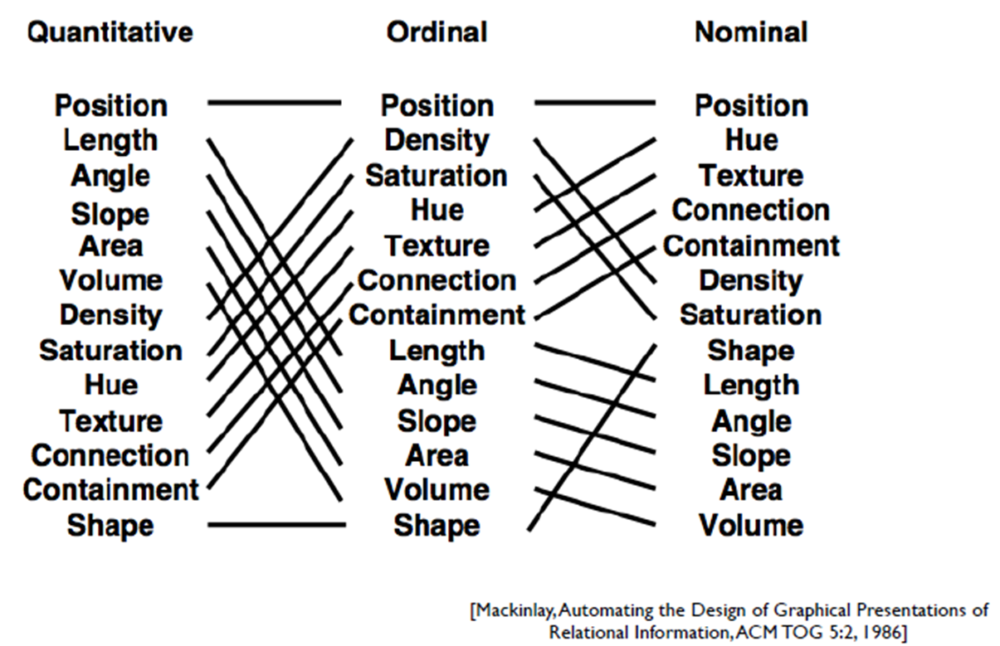
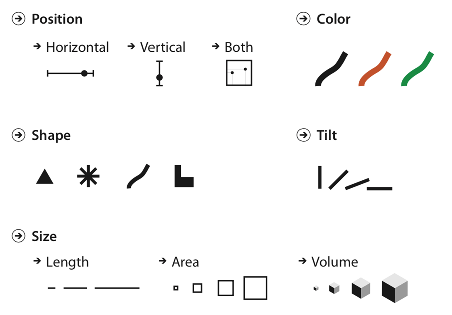
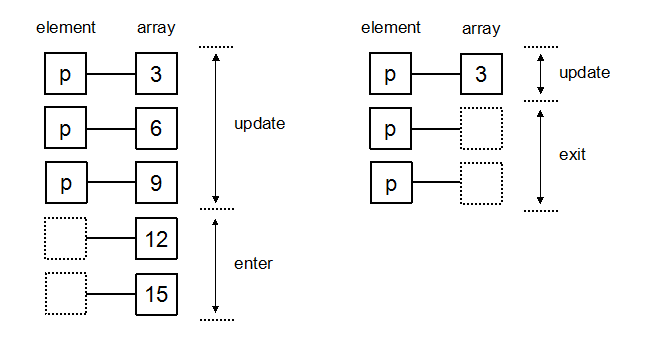

# 第 1 章 数据

数据来源、属性与变换，构成 D3 绘图的基础。

## 1.1 数据生成与读取

### 新生数据案例

本章从一份包含 80 条新生记录的 CSV 文件开始，学习数据的读取、类型转换和整理。CSV 的第一行是字段名，后面每一行是一条记录。原课程的字段包括序号、姓名、性别、生日、年龄、班级、籍贯和民族。

### 字段、记录与数据类型

| 字段示例 | 含义 | 读入后的处理 |
| --- | --- | --- |
| 序号 / id | 标识一条记录 | 保留为标识，用于查找和数据连接 |
| 姓名、班级 | 文本或类别 | 去除首尾空格，统一名称 |
| 年龄、成绩 | 数值 | 从字符串转换为 Number |
| 生日、日期 | 时间 | 按指定格式解析为 Date |

读入 CSV 后，`"18"` 与 `18` 并不是同一种类型。字符串用于显示没有问题，参与加法、排序或计算均值前，需要先完成类型转换。例如 `"18" + "2"` 得到 `"182"`，而 `18 + 2` 得到 `20`。

### 数据读取与行转换

`d3.csv(url, transformRow)` 负责加载和解析 CSV，并把每一行交给 `transformRow`。在这个函数中完成字段重命名、去除空格、数值转换和日期解析，后面的过滤、分组和绘图就可以使用统一的数据结构。

整理数据时还要检查字段是否齐全、同一类别的写法是否一致、日期格式是否统一。空字符串应先单独处理，再做数值转换；`Number("")` 会得到 0。

### 关键代码

#### 1. 字段名映射

```javascript
// 左侧是 CSV 列名，右侧是程序内部使用的字段名。
const COLUMN_MAP = {
  '序号': 'id', '姓名': 'name', '性别': 'gender',
  '生日': 'birthday', '年龄': 'age', '班级': 'class'
};
// Object.entries 把对象转换为 [键, 值] 数组。
const row = {'序号': '1', '姓名': '张明', '年龄': '18'};
const mapped = Object.fromEntries(
  Object.entries(row).map(([key, value]) => [COLUMN_MAP[key] ?? key, value])
);
console.log(mapped); // {id: '1', name: '张明', age: '18'}
```

**关键点解释**

对象中的 `key: value` 建立字段对应关系。`[key, value]` 是数组解构；`?? key` 表示没有配置映射时沿用原列名。中文属性名在 JavaScript 中合法；映射为英文名是为了让后面的代码采用统一命名。此时字段名变了，字段值仍是字符串。

#### 2. 类型转换函数

```javascript
// 先指定格式，再得到一个可重复使用的日期解析函数。
const parseDate = d3.utcParse('%Y-%m-%d');
function transformRow(row) {
  const age = row['年龄'].trim();
  return {
    id: row['序号'],                         // 编号保留字符串。
    name: row['姓名'].trim(),                // 去掉首尾空格。
    birthday: parseDate(row['生日']),        // 字符串转换为 Date。
    age: age === '' ? null : Number(age),   // 空项与数字分别处理。
    class: row['班级'].trim()
  };
}
```

**关键点解释**

`transformRow` 接收一行对象，`return { ... }` 返回新的记录。`Number("18")` 与 `+"18"` 都得到数字 18，后一种写法中的 `+` 是一元加运算符。两者都会把空字符串转成 0，因此先用 `trim()` 去掉首尾空格，再把空项单独记为 `null`。`utcParse` 按明确格式解释日期。把转换放在同一处，后续计算就不必反复判断字段类型。

#### 3. d3.csv 的行回调与 await

```javascript
// transformRow 是上一段定义的函数，这里传函数本身。
const url = new URL('../assets/data/original-students.csv', import.meta.url);
const students = await d3.csv(url, transformRow);
// await 得到解析后的记录数组，而不是 Promise。
console.log(students.length);                    // 80
console.log(typeof students[0].age);             // 'number'
console.log(students[0].birthday instanceof Date); // true
```

**关键点解释**

`d3.csv` 返回 Promise，可以用 `await` 或 `.then()` 取得结果。第二个参数是行转换函数，D3 会对解析出的每一行调用它，返回值进入最终数组。这里写 `transformRow`，不是 `transformRow()`；后者会立即调用函数。

### 运行示例: 读取 CSV 与转换字段

```javascript
async function csv({svg,d3,n}) {
  // 行回调在解析时转换类型；编号仍是字符串。
  const rows=await d3.csv(new URL('../assets/data/students.csv',import.meta.url),row=>({
    id:row.id, score:row.score.trim()===''?null:Number(row.score)
  }));
  const shown=rows.slice(0,n);
  // 比例尺把成绩转为像素，不修改成绩。
  const x=d3.scaleLinear().domain([0,100]).range([0,440]);
  svg.selectAll('rect').data(shown,d=>d.id).join('rect')
    .attr('x',80).attr('y',(d,i)=>20+i*24).attr('width',d=>x(d.score??0))
    .attr('height',16).attr('fill','#2878ad');
  svg.selectAll('text').data(shown).join('text')
    .attr('x',10).attr('y',(d,i)=>33+i*24).text(d=>d.id);
  return {rows:rows.length,scoreType:typeof rows[0].score,first:rows[0]};
}
```


[D3 官方文档](https://d3js.org/d3-fetch)

### 演示观察

切换原始字符串与转换后的数值，比较成绩列的 typeof；再选中一条记录，观察编号是否改变。

[打开本节](https://mississippipotato.github.io/recreate/#ch-1-1)

## 1.2 数据定义与 DIKW

### DIKW 金字塔

DIKW 分别指数据（Data）、信息（Information）、知识（Knowledge）和智慧（Wisdom）。数据是原始的观察结果，信息是组织好的数据，知识是从信息中提炼的模式和规律，智慧是运用知识作出判断和决策。

| 层 | 含义 | 回答的问题 |
| --- | --- | --- |
| 数据 Data | 原始、离散的观察结果 | 记录了什么 |
| 信息 Information | 经过处理、组织、赋予上下文的数据 | 谁 / 什么 / 何时 / 何地 |
| 知识 Knowledge | 对信息的进一步提炼和理解 | 如何 |
| 智慧 Wisdom | 运用知识作出判断和决策 | 为什么 / 应该怎么做 |

### 可视化在 DIKW 中的位置

可视化把表格中的数据转换成图形，使分布、差异和联系更容易被发现。柱状图可以比较各班人数，折线图可以观察变化，热图可以查找集中出现的高值和低值。

- **Data → Information：**整理和呈现数据，回答具体问题。
- **Information → Knowledge：**比较多个视图，发现模式，结合领域知识、统计分析进一步解释。
- **Knowledge → Wisdom：**结合目标、经验和条件作出决策，可视化提供分析依据。

### 从记录到判断

以新生数据为例：一条记录中的班级、年龄和籍贯属于数据；按班级统计人数形成信息；比较多个班级的构成可以发现规律；结合教学安排决定如何分组，则进入了决策。演示中的四层金字塔用同一份记录说明这个过程。

### 关键代码

#### 1. 用 SVG path 画金字塔的一层

```javascript
const cx = 200;                       // 水平中心。
const topW = 60, bottomW = 120;        // 上边宽度和下边宽度。
const yTop = 20, yBottom = 100;
// M 移到起点，L 连到下一点，Z 闭合路径。
const path = `M ${cx-topW/2} ${yTop}
  L ${cx+topW/2} ${yTop}
  L ${cx+bottomW/2} ${yBottom}
  L ${cx-bottomW/2} ${yBottom} Z`;
const layer = {name:'Data',color:'#2878ad'};
const groups = svg.selectAll('g.layer').data([layer]).join('g').attr('class','layer');
groups.append('path').attr('d', path).attr('fill',d=>d.color);
```

**关键点解释**

`path` 的 `d` 属性保存路径指令。模板字符串中的 `${表达式}` 会先计算坐标，再拼成字符串。改变上下边宽度就可以得到不同梯形；把四层依次排列，就能组成 DIKW 金字塔。

#### 2. 绑定数据、事件与交互高亮

```javascript
// groups 是上一段包含 path 的图层选择集。
groups.on('mouseenter', function(event, d) {
  // 普通函数中的 this 是正在处理事件的 g。
  d3.select(this).select('path').interrupt().transition().duration(150)
    .attr('fill', d3.color(d.color).brighter(0.5));
});
// 箭头函数可用 event.currentTarget 取得相同元素。
groups.on('click', (event, d) => {
  d3.select(event.currentTarget).classed('selected', true);
  console.log(d.name);
});
```

**关键点解释**

`.on(type, listener)` 把事件监听器绑定到选择集，回调参数依次是事件 `event` 和当前数据 `d`。使用 `this` 时写普通函数；使用箭头函数时可以写 `event.currentTarget`。`transition().duration(150)` 在 150 毫秒内插值颜色。

### 运行示例: DIKW 金字塔与路径

```javascript
function dikw({svg,d3,n,L}) {
  const labels=L(['数据','信息','知识','智慧'],['Data','Information','Knowledge','Wisdom']);
  // 每个梯形绑定一层；索引 0 在底部，3 在顶部。
  const layers=labels.map((label,i)=>({label,index:i,top:155-i*48,width:380-i*85}));
  const groups=svg.selectAll('g').data(layers).join('g');
  groups.append('path').attr('d',d=>{
    const cx=300,top=d.top,w=d.width;
    // 按顺序画四个顶点，最后闭合。
    return `M${cx-(w-65)/2},${top}L${cx+(w-65)/2},${top}L${cx+w/2},${top+42}L${cx-w/2},${top+42}Z`;
  }).attr('fill',d=>d.index===n-1?'#e16a45':'#2878ad');
  groups.append('text').attr('x',300).attr('y',d=>d.top+28).attr('text-anchor','middle')
    .attr('fill','white').text(d=>d.label);
  return {selected:labels[n-1],level:n};
}
```


[D3 官方文档](https://d3js.org/d3-selection/events)

### 演示观察

点击金字塔的四层，比较同一份记录如何组织成信息、知识与决策。

[打开本节](https://mississippipotato.github.io/recreate/#ch-1-2)

## 1.3 数据属性与视觉通道

### 数据属性的三种基本类型

- **类别型属性：**符号或名称，没有大小顺序，如姓名、专业和籍贯。
- **序数型属性：**属性值有顺序，如本科、硕士、博士，或低、中、高。
- **数值型属性：**表示可以度量的数量，如年龄、价格、人数和温度。

### Stevens 测量尺度

测量尺度进一步区分了数据允许怎样比较。特别要注意：区间尺度有等距的差值，比率尺度还具有有意义的零点。

| 尺度 | 可以怎样比较 | 典型示例 |
| --- | --- | --- |
| 名义 Nominal | 相同 / 不同 | 姓名、专业、编号 |
| 序数 Ordinal | 相同 / 不同，以及先后或高低 | 等级、名次 |
| 区间 Interval | 比较差值 | 摄氏温度、年份 |
| 比率 Ratio | 比较差值与倍数 | 人数、长度、价格 |

0°C 不表示没有温度，因此不能说 20°C 是 10°C 的两倍。人数则有零点，20 人是 10 人的两倍。编号即使用数字存储，仍然属于类别型属性。

### 属性与视觉通道的匹配

| 表达任务 | 常用通道 | 图形例子 |
| --- | --- | --- |
| 比较数量 | 共用尺度上的位置、长度 | 散点图、柱状图 |
| 表达顺序 | 位置、明度、大小 | 排序图、顺序色带 |
| 区分类别 | 色相、形状、空间分区 | 分类散点、分面图 |

Mackinlay 的视觉通道排序为这种选择提供了依据。先判断字段的含义，再决定使用哪一种比例尺和通道；例如专业用类别颜色，成绩用位置或长度。





### 关键代码

#### 1. 根据属性选择比例尺

```javascript
// 连续数值：成绩 0~100 映射到像素 0~800。
const x = d3.scaleLinear().domain([0, 100]).range([0, 800]);
console.log(x(50)); // 400
// 离散类别：每个班级分到一个带宽相同的区间。
const band = d3.scaleBand()
  .domain(['软件1班', '软件2班']).range([0, 800]).padding(0.1);
console.log(band('软件1班'), band.bandwidth());
// scalePoint 为离散类别分配位置，不分配矩形带宽。
const point = d3.scalePoint().domain(['低','中','高']).range([0, 800]);
```

**关键点解释**

`domain` 是输入域，`range` 是输出域，比例尺本身是可以调用的函数。`x(50)` 得到对应像素；`band(category)` 得到柱子的起点，`bandwidth()` 得到柱宽。数据是连续数量还是离散类别，决定了这里应使用哪类比例尺。

#### 2. 顺序型、发散型和定性型颜色

```javascript
// 有大小顺序：把人数范围先归一化，再调用 Viridis。
const sequential = d3.scaleSequential(d3.interpolateViridis).domain([0, 100]);
// 有基准值：三项 domain 分别是低端、中点、高端。
const diverging = d3.scaleDiverging(d3.interpolateRdBu).domain([-10, 0, 10]);
// 无序类别：显式给出类别与颜色数组。
const categorical = d3.scaleOrdinal()
  .domain(['A', 'B', 'C']).range(d3.schemeTableau10);
console.log(sequential(50), diverging(0), categorical('B'));
```

**关键点解释**

`interpolateViridis(t)` 接收 0 到 1 的参数；`scaleSequential` 负责把原始数值转为这个参数。`scaleDiverging` 还明确一个中点。`scaleOrdinal` 则按类别在颜色数组中查找，不计算类别之间的中间颜色。

### 运行示例: 比例尺与坐标轴

```javascript
function scales({svg,d3,n}) {
  const values=[0,25,50,75,100];
  // domain 是输入，range 是输出；n 控制屏幕宽度。
  const x=d3.scaleLinear().domain([0,100]).range([40,40+n*40]);
  svg.selectAll('circle').data(values).join('circle')
    .attr('cx',d=>x(d)).attr('cy',95).attr('r',8).attr('fill','#2878ad');
  // call 将选择集交给坐标轴生成器。
  svg.append('g').attr('transform','translate(0,130)').call(d3.axisBottom(x).ticks(4));
  return values.map(value=>({value,pixel:x(value)}));
}
```


[D3 官方文档](https://d3js.org/d3-scale/linear)

### 演示观察

切换编号、等级、温度和人数。观察相同的数值，为什么需要不同的颜色逻辑。

[打开本节](https://mississippipotato.github.io/recreate/#ch-1-3)

## 1.4 数据变换

### 常见的数据变换

数据通常需要先整理，再绑定到图形。原课程介绍了八种常见操作，分别处理逐项映射、筛选、组合和数组结构。

| 操作 | 作用 | 简单例子 |
| --- | --- | --- |
| map | 逐项生成新值 | 年龄数组 → 每人下一岁的年龄 |
| reduce | 把多个值归约为一个结果 | 年龄数组 → 总和 |
| cross | 笛卡尔积 | 性别 × 专业 → 所有组合 |
| merge | 把多组数组展开一层 | [[1,2],[3]] → [1,2,3] |
| pairs | 提取相邻元素对 | [1,2,3] → [[1,2],[2,3]] |
| transpose | 交换矩阵的行与列 | 两行三列 → 三行两列 |
| zip | 按相同索引组合 | [1,2] 与 [a,b] → [[1,a],[2,b]] |
| filter | 保留满足条件的记录 | 学生数组 → 某专业的学生 |

### 用函数组合表达数据流

例如计算某一组学生的平均年龄，可以先用 `filter` 选出记录，再用 `map` 提取年龄，最后用 `reduce` 求和。每一步处理上一层的结果，便于逐步检查中间值。

`map` 和 `filter` 会返回新数组；`reduce` 返回什么取决于累加器。写回调时，尽量只计算并返回结果，让输入记录保持不变。

### 分组与聚合

`d3.group` 按字段把记录分组，组内仍保留完整记录；`d3.rollup` 在分组后计算人数、总和或均值。下一章会把“专业 → 班级 → 人数”的多层聚合结果继续转换为树形结构。

### 关键代码

#### 1. filter、map、reduce 的组合

```javascript
// filter 的回调返回布尔值，决定是否保留记录。
const group = students.filter(student => student.gender === '男');
// map 返回与输入长度相同的新数组，这里只保留年龄。
const ages = group.map(student => student.age);
// sum 是累加器；0 是初始值。
const total = ages.reduce((sum, age) => sum + age, 0);
const mean = ages.length ? total / ages.length : null;
console.log({ages, total, mean});
```

**关键点解释**

箭头函数 `student => student.age` 省略了 `return`；如果函数体写成花括号，就需要显式返回。`reduce` 每轮把上次结果作为下一轮的累加器，最终返回这里的数值总和。先保存筛选结果，也避免为求人数再次筛选。

#### 2. cross：笛卡尔积

```javascript
const genders = ['男', '女'];
const majors = ['软件工程', '数据科学'];
// 每个性别与每个专业各组合一次，共 2×2 项。
const pairs = d3.cross(genders, majors);
// 最后的函数把每个组合转换为对象。
const rows = d3.cross(genders, majors, (gender, major) => ({gender, major}));
console.log(pairs, rows);
```

**关键点解释**

`cross` 的输入可以是多个可迭代对象，结果数量是各输入长度的乘积。最后一个参数可以是 reducer，它接收一次组合中的各项。`({gender, major})` 外面的圆括号让箭头函数返回对象字面量。

#### 3. group 与 rollup

```javascript
// group 的每个值仍是完整记录数组。
const byClass = d3.group(students, student => student.class);
// rollup 先分组，再让 reducer 计算每组的值。
const countByClass = d3.rollup(students, group => group.length, student => student.class);
// Map 的 get 按键读取，entries 提供键值对。
console.log(byClass.get('软件工程1班'));
for (const [className, count] of countByClass) console.log(className, count);
```

**关键点解释**

`group` 与 `rollup` 都返回 Map 结构。区别在最内层：前者是记录数组，后者是 reducer 的返回值。`for...of` 遍历 Map 时，每一项是 `[key, value]`，可以直接解构。

### 运行示例: filter → map → sum

```javascript
function arrays({svg,d3,n}) {
  const values=d3.range(1,n+1);
  // 先筛选，再映射；原数组仍保留。
  const result=values.filter(d=>d%2===0).map(d=>d*d);
  const x=d3.scaleBand().domain(d3.range(result.length)).range([30,540]).padding(.25);
  const y=d3.scaleLinear().domain([0,n*n]).range([170,15]);
  svg.selectAll('rect').data(result).join('rect').attr('x',(d,i)=>x(i))
    .attr('y',d=>y(d)).attr('width',x.bandwidth()).attr('height',d=>170-y(d)).attr('fill','#2878ad');
  return {input:values,result,sum:d3.sum(result)};
}
```


[D3 官方文档](https://d3js.org/d3-array/transform)

### 演示观察

选择一种操作，先读输入，再读输出。注意结果的类型、长度和嵌套层数。

[打开本节](https://mississippipotato.github.io/recreate/#ch-1-4)

## 1.5 D3 选择集与数据连接

### D3 选择器

| 方法 | 选择范围 |
| --- | --- |
| d3.select | 第一个匹配的元素 |
| d3.selectAll | 所有匹配的元素 |
| selection.select | 每个父元素中第一个匹配的后代 |
| selection.selectAll | 每个父元素中所有匹配的后代 |
| selection.selectChild | 每个父元素中第一个匹配的直接子元素 |
| selection.selectChildren | 每个父元素中所有匹配的直接子元素 |

这些方法返回的是 **selection（选择集）**。后续的 `attr`、`style`、`text` 和 `on` 都作用于选择集中的元素。

### Data-Join：enter / update / exit

数据连接把数据数组与 DOM 元素对应起来。调用 `selection.data(data, key)` 后，可以根据匹配结果得到三种状态。

| 状态 | 匹配情况 | 常见操作 |
| --- | --- | --- |
| enter | 新数据没有对应元素 | append 创建元素 |
| update | 数据与已有元素匹配 | 更新位置、颜色、文字 |
| exit | 已有元素没有对应的新数据 | remove 移除元素 |

例如旧数据为 A、B、C，新数据为 B、C、D，按字母作 key：B、C 更新，D 进入，A 退出。虽然两次数组长度相同，仍然会同时出现 enter 和 exit。

### key 函数与元素身份

省略 key 时，D3 按索引匹配；使用 `d => d.id` 时，D3 按编号匹配。数据重新排序时，稳定的 key 能保留原来的元素，随后再改变它的位置。`join` 把创建、更新和删除放在同一段流程中处理。



### 关键代码

#### 1. join 的三种回调

```javascript
const circles = svg.selectAll('circle')
  .data(currentData, d => d.id) // 用稳定编号匹配旧元素。
  .join(
    enter => enter.append('circle').attr('fill', '#e16a45'), // 创建。
    update => update.attr('fill', '#2878ad'),                // 复用。
    exit => exit.remove()                                  // 删除。
  );
// join 合并 enter 与 update，后面统一设置位置。
circles.attr('cx', (d, i) => 40 + i * 60).attr('cy', 80).attr('r', 20);
```

**关键点解释**

`enter`、`update`、`exit` 参数都是对应状态的选择集。箭头函数返回创建或更新后的选择集，`join` 才能合并它们并继续链式调用。把公共的大小、位置放在 `join` 后面，可以同时设置新旧元素。

#### 2. 按索引与按 key 匹配

```javascript
const oldData = [{id:'A'}, {id:'B'}, {id:'C'}];
const newData = [{id:'B'}, {id:'C'}, {id:'D'}];
const indexGroup=svg.append('g'), keyGroup=svg.append('g');
indexGroup.selectAll('circle').data(oldData).join('circle');
keyGroup.selectAll('circle').data(oldData,d=>d.id).join('circle');
// 两个独立分组对照，避免一次连接影响另一次连接。
const byIndex = indexGroup.selectAll('circle').data(newData);
// 指定 key：B、C 复用，D 进入，A 退出。
const byId = keyGroup.selectAll('circle').data(newData, d => d.id);
console.log(byId.enter().size(), byId.size(), byId.exit().size());
```

**关键点解释**

这两种写法是两种匹配方式，演示中可以分别选择。`d => d.id` 会对已有元素和新数据求 key，按相同 key 匹配。key 应稳定且能区分记录。重排只改变顺序时，按 key 可以继续使用原来的 DOM 节点。

#### 3. select 与 selectAll

```javascript
// select 取第一个匹配项，常用于容器、标题和单个提示框。
const title = d3.select('#title').text('人数');
// selectAll 可以得到空选择集；数据连接负责补齐元素。
const bars = d3.select('#chart').selectAll('rect.bar')
  .data([3, 5, 8]).join('rect').attr('class', 'bar');
// 回调的 d 是当前数据，i 是当前组中的索引。
bars.attr('x', (d, i) => i * 40).attr('width', 30).attr('height', d => d * 10);
```

**关键点解释**

`selectAll` 找到的是元素，不会自动创建它们。即使开始没有任何 `rect.bar`，`data(...).join("rect")` 也可以创建所需矩形。传给 `attr` 的函数由 D3 逐元素调用，而固定值会应用到整个选择集。

### 运行示例: data → join → attr

```javascript
function join({svg,d3,n}) {
  const rows=['A','B','C','D','E','F','G','H'].slice(0,n).map(id=>({id}));
  // key 按身份匹配；省略时按索引匹配。
  const marks=svg.selectAll('circle').data(rows,d=>d.id);
  const counts={enter:marks.enter().size(),update:marks.size(),exit:marks.exit().size()};
  marks.join(
    // enter 与 update 返回选择集，供后续链式设置。
    enter=>enter.append('circle').attr('fill','#e16a45'),
    update=>update.attr('fill','#2878ad'),
    exit=>exit.remove()
  ).attr('cx',(d,i)=>45+i*65).attr('cy',100).attr('r',22);
  svg.selectAll('text').data(rows,d=>d.id).join('text').attr('x',(d,i)=>45+i*65)
    .attr('y',105).attr('text-anchor','middle').attr('fill','white').text(d=>d.id);
  return counts;
}
```


[D3 官方文档](https://d3js.org/d3-selection/joining)

### 演示观察

比较替换、重排、增加与删除；再切到按索引匹配，观察同一个 DOM 编号对应哪个数据。

[打开本节](https://mississippipotato.github.io/recreate/#ch-1-5)
